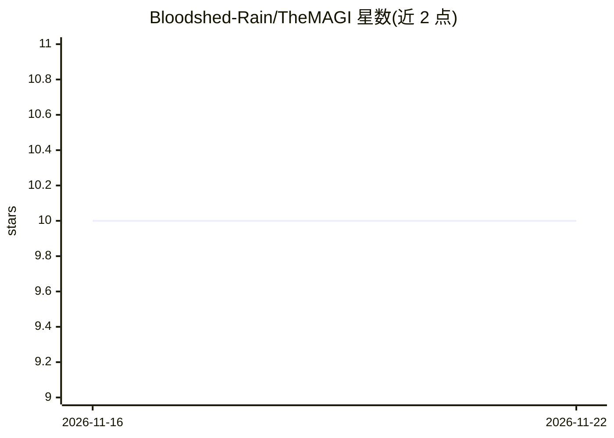

# Bloodshed-Rain/TheMAGI

⭐ 10 · TypeScript · MIT · 推送 2026-11-16 · [GitHub](https://github.com/Bloodshed-Rain/TheMAGI) · [官网](https://themagi.gg) · 组织维护

**面向 Melee 玩家的本地 Slippi 录像统计与 AI 教练应用**

基于 Electron 的桌面应用，读取 Slippi .slp 录像文件并解析其帧数据，提供统计面板（角色、趋势、对局、对手侦察）、Game Theater 回放定位与片段播放、以及可勾选的练习计划。AI 部分为可选项：Cornerman 局间建议、Oracle 问答、练习计划与侦察报告使用用户自行选择的 AI 服务（ChatGPT 登录或本地模型），本地优先，录像与统计数据保留在本机，不上传原始录像。Windows 可在应用内运行 Slippi 游戏，macOS/Linux 支持统计与教练功能。

## 筛选速览

| 维度 | 判定 | 备注 |
|---|---|---|
| AI 角色 | `ai-native` | 本体是模型或模型工具 |
| 许可风险 | `permissive` | MIT |
| 部署形态 | `None` |  |
| 模型依赖 | — | README 未给出锁定关系 |
| 硬件要求 | — | 无带数字的原话,不猜 |
| 安装摩擦 | `low` | 无编译、无系统依赖或容器化 |
| 成熟度 | — | 结构信号不足 |

## 能力要点

- 读取 .slp 录像帧数据生成统计，公开统计口径定义与已知局限
- Cornerman 局间建议与语音播报，实时统计无需 AI
- Oracle 对录像数据提问，Practice 生成带勾选的练习计划
- 数据本地优先，在线教练只发送相关比赛信息与问题

## 适用场景

- 复盘自己的 Melee 对局并定位关键片段
- 根据近期战绩生成下一步练习计划
- 分析对手习惯并准备对战策略

## 场景标签

`AI 助手` `数据分析` · 领域:效率与自动化

## 证据(README 行号)

> L75: Practice plans, Oracle answers, scouting reports, and Cornerman advice use the AI service you choose. Treat the sug
> L103: For coaching, you can connect ChatGPT, use another AI service, or run a model on your own computer. If you use Cha
> L111: When you ask an online AI service for coaching, MAGI sends it the relevant game information and your question. It 

## 星数曲线

2026-11-16 10 → 2026-11-22 10（+0）

---
*卡片 v1 · prompt 1.4 · 生成 2026-11-20 · 置信度 high · 依据 README sha `d72e1e4c02cd` · [字段定义](../../DATASET.md)*
