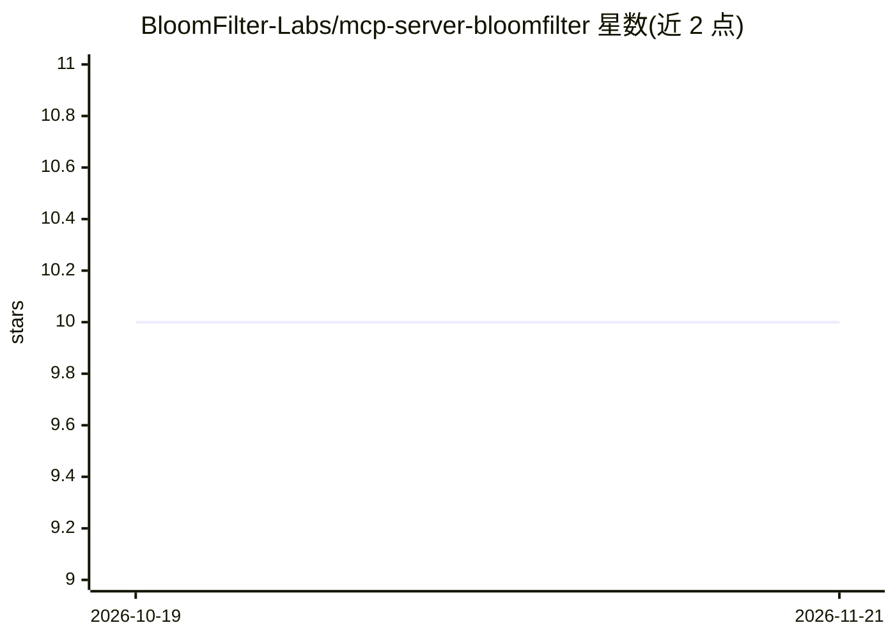

# BloomFilter-Labs/mcp-server-bloomfilter

⭐ 10 · TypeScript · MIT · 推送 2026-02-26 · [GitHub](https://github.com/BloomFilter-Labs/mcp-server-bloomfilter) · [官网](https://npmjs.com/package/@bloomfilter/mcp-server) · 组织维护

**给 AI Agent 提供域名搜索注册与 DNS 管理的 MCP 服务器**

包装 Bloomfilter 域名注册 API 的 MCP 服务器，让 MCP 兼容客户端（Claude Desktop、Cursor 等）可调用 10 个工具：免费查询域名可用性与价格，通过钱包认证后注册/续费域名并管理 DNS 记录。付费走 x402 协议，用 Base 链上 USDC 自动支付，认证用 SIWE。通过 stdio JSON-RPC 由 MCP 客户端启动，无独立运行界面；无私钥时仅查询类工具可用。

## 筛选速览

| 维度 | 判定 | 备注 |
|---|---|---|
| AI 角色 | `ai-ecosystem` | LLM/agent 周边工具 |
| 许可风险 | `permissive` | MIT |
| 部署形态 | `library` | 以包/库形式分发 |
| 模型依赖 | — | README 未给出锁定关系 |
| 硬件要求 | — | 无带数字的原话,不猜 |
| 安装摩擦 | `low` | 无编译、无系统依赖或容器化 |
| 成熟度 | — | 结构信号不足 |

## 能力要点

- 暴露 10 个工具：域名搜索、定价查询、注册、续费与 DNS CRUD
- x402 协议自动完成 USDC 支付与异步开通流程
- SIWE 钱包认证，无需登录、信用卡或控制台
- 支持任意兼容 stdio 的 MCP 客户端

## 适用场景

- 让 AI Agent 自主搜索并注册域名
- 通过对话客户端为已注册域名增删改 DNS 记录
- 无钱包环境下批量查询域名可用性与各 TLD 价格

## 场景标签

 · 领域:AI Agent 工具/域名与 DNS 服务

## 证据(README 行号)

> L7: MCP server for Bloomfilter, search & register domain names and manage DNS records from AI agents.
> L13: This MCP server wraps the Bloomfilter API so that any MCP-compatible client (Claude Desktop, Cursor, Windsurf, cust
> L21: The server communicates over stdio (JSON-RPC). It's meant to be launched by an MCP client, not run standalone.

## 星数曲线

2026-10-19 10 → 2026-11-21 10（+0）

---
*卡片 v1 · prompt 1.4 · 生成 2026-11-20 · 置信度 high · 依据 README sha `890e43eaecf2` · [字段定义](../../DATASET.md)*
