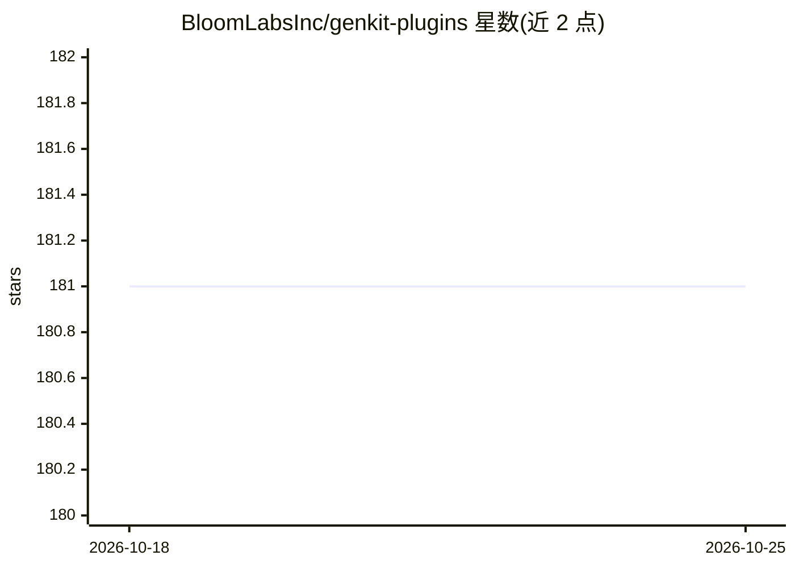

# BloomLabsInc/genkit-plugins

⭐ 181 · TypeScript · Apache-2.0 · 推送 2026-07-15 · [GitHub](https://github.com/BloomLabsInc/genkit-plugins) · [官网](https://bloomlabsinc.github.io/genkit-plugins/) · 组织维护

**Firebase Genkit 的社区插件集：接入多家模型 API 与向量库**

由 Bloom Labs 团队维护的 Genkit 社区插件 monorepo（lerna 管理），为 Google Firebase Genkit 框架提供模型/嵌入插件（Anthropic、Cohere、Groq、Mistral、OpenAI、Azure OpenAI）、向量存储插件（Convex、HNSW、Milvus）以及 Graph 工作流插件。以 npm 包形式按需安装（npm/yarn/pnpm），面向已使用 Genkit 的开发者。仓库依赖 Genkit 本体，Genkit 相关问题需去官方仓库反馈。

## 筛选速览

| 维度 | 判定 | 备注 |
|---|---|---|
| AI 角色 | `ai-ecosystem` | LLM/agent 周边工具 |
| 许可风险 | `permissive` | Apache-2.0 |
| 部署形态 | `library` | 以包/库形式分发 |
| 模型依赖 | locked-api |  |
| 硬件要求 | — | 无带数字的原话,不猜 |
| 安装摩擦 | `low` | 无编译、无系统依赖或容器化 |
| 成熟度 | — | 结构信号不足 |

## 能力要点

- 6 个模型/嵌入插件（Anthropic/Cohere/Groq/Mistral/OpenAI/Azure OpenAI）
- 3 个向量存储插件（Convex/HNSW/Milvus）
- genkitx-graph 图工作流插件
- Apache 2.0 许可，lerna 管理的 monorepo

## 适用场景

- 在 Genkit 应用中接入 OpenAI/Anthropic 等模型 API
- 为 Genkit 检索流程接入 Milvus 等向量数据库
- 查看基于 genkit-plugins 构建的产品案例

## 场景标签

`模型网关` · 领域:Agent 开发

## 证据(README 行号)

> L15: This repository contains community plugins for
> L22: - `genkitx-anthropic` - Plugin for Anthropic AI APIs
> L31: - `genkitx-convex` - Plugin for Convex Vector Stores

## 星数曲线

2026-10-18 181 → 2026-10-25 181（+0）

---
*卡片 v1 · prompt 1.4 · 生成 2026-10-22 · 置信度 high · 依据 README sha `ef7192bca6c9` · [字段定义](../../DATASET.md)*
