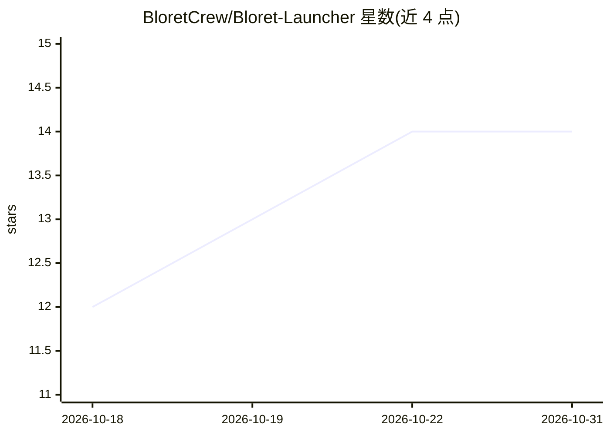

# BloretCrew/Bloret-Launcher

⭐ 14 · Python · GPL-3.0 · 推送 2026-10-21 · [GitHub](https://github.com/BloretCrew/Bloret-Launcher) · [官网](https://launcher.bloret.net) · 组织维护 · 中文 README

**开源 AI Minecraft 启动器：版本下载、多账号、模组与联机管理**

用 Python/Nuitka 构建的 Minecraft 启动器，功能包括 Minecraft 下载与启动、版本与服务器管理、模组与资源包管理（Bloriko 支持 Modrinth）、Microsoft/离线/Bloret PassPort 多种登录方式、EasyTier P2P 联机、托盘图标与自动更新等。AI 能力体现在产品定位（AI Launcher）与 Bloriko/Bloriko DeepThink 功能。平台覆盖 Windows（安装包/zip/WinGet）、Linux（源码/AppImage/PKGBUILD）、macOS（CI 产物）与 FreeBSD（源码运行）。

## 筛选速览

| 维度 | 判定 | 备注 |
|---|---|---|
| AI 角色 | `ai-enhanced` | 去掉 AI 部分产品仍成立 |
| 许可风险 | `viral` | GPL-3.0 |
| 部署形态 | `desktop` | 安装包/桌面程序 |
| 模型依赖 | — | README 未给出锁定关系 |
| 硬件要求 | — | 无带数字的原话,不猜 |
| 安装摩擦 | `low` | 无编译、无系统依赖或容器化 |
| 成熟度 | — | 结构信号不足 |

## 能力要点

- 支持 Microsoft/离线/Bloret PassPort 登录及多 Minecraft 账户
- Bloriko 模组功能，含 Modrinth 集成与 DeepThink
- EasyTier P2P 联机与服务器管理
- Windows/Linux/macOS/FreeBSD 四平台支持

## 适用场景

- 下载并启动 Minecraft，管理版本、模组与资源包
- 与好友通过 EasyTier 联机加入同一世界
- 同时管理多个 Minecraft 账户

## 场景标签

 · 领域:游戏/桌面工具

## 证据(README 行号)

> L5:  Be creative, be simple. Your Personal Innovative Open Source AI Minecraft Launcher. Relax, it's Bloret Launcher.
> L96: - [x] Bloriko DeepThink

## 星数曲线

2026-10-18 12 → 2026-10-31 14（+2）

---
*卡片 v1 · prompt 1.4 · 生成 2026-10-31 · 置信度 mid · 依据 README sha `4f39e1181a9c` · [字段定义](../../DATASET.md)*
