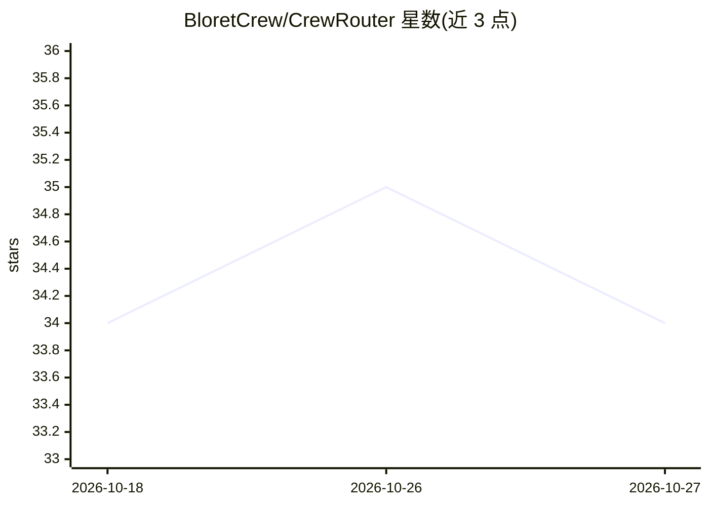

# BloretCrew/CrewRouter

⭐ 34 · JavaScript · GPL-3.0 · 推送 2026-10-21 · [GitHub](https://github.com/BloretCrew/CrewRouter) · [官网](https://crewrouter.bloret.net) · 组织维护 · 中文 README

**团队级 AI 模型统一网关：一个端点聚合多供应商**

自托管的 AI 模型网关，将 OpenAI、Anthropic、DeepSeek 等多家上游供应商聚合为一个 OpenAI / Anthropic 兼容端点，团队成员只需更改 base_url 即可在 Claude Code、Cursor 等客户端使用。功能包括协议双向转换、按团队分配模型的智能路由、Fusion 多模型并发与裁判综合、实时统计、Key 管理与轮换、代理池、计费与权限分层、沙箱插件系统。需 Node.js 与 PostgreSQL，提供一键包、Docker 与源码三种部署方式，GPL-3.0 许可。

## 筛选速览

| 维度 | 判定 | 备注 |
|---|---|---|
| AI 角色 | `ai-ecosystem` | LLM/agent 周边工具 |
| 许可风险 | `viral` | GPL-3.0 |
| 部署形态 | `self-host` | docker 或自建部署 |
| 模型依赖 | locked-api |  |
| 硬件要求 | — | 无带数字的原话,不猜 |
| 安装摩擦 | `low` | 无编译、无系统依赖或容器化 |
| 成熟度 | — | 结构信号不足 |

## 能力要点

- 多供应商聚合为单一 OpenAI/Anthropic 兼容端点，协议双向转换
- Fusion 模式：同一请求并发多模型并由裁判模型综合
- API Key 管理：时间调度、模型绑定、动态轮换、密钥对成员不可见
- 沙箱插件框架与插件商店，中英双语国际化

## 适用场景

- 团队统一管理多家模型供应商的访问与密钥
- 在 Claude Code / Cursor 等工具中只改 base_url 接入网关
- 按团队分配模型、限额与计费，追踪请求量、Token 与成本

## 场景标签

`模型网关` · 领域:Agent 开发

## 证据(README 行号)

> L15: **团队级 AI 模型统一网关** · OpenAI / Anthropic 双协议 · 自托管
> L29: CrewRouter 把多家上游模型供应商收成 **一个 OpenAI / Anthropic 兼容端点**。团队成员只拿网关下发的 Key，用 Claude Code、Codex、Cursor、OpenCode、Cherry S
> L35: - [x] **多供应商聚合** — OpenAI、Anthropic、DeepSeek 等，一个端点全部接入

## 星数曲线

2026-10-18 34 → 2026-10-27 34（+0）

---
*卡片 v1 · prompt 1.4 · 生成 2026-10-25 · 置信度 high · 依据 README sha `d45de64490eb` · [字段定义](../../DATASET.md)*
