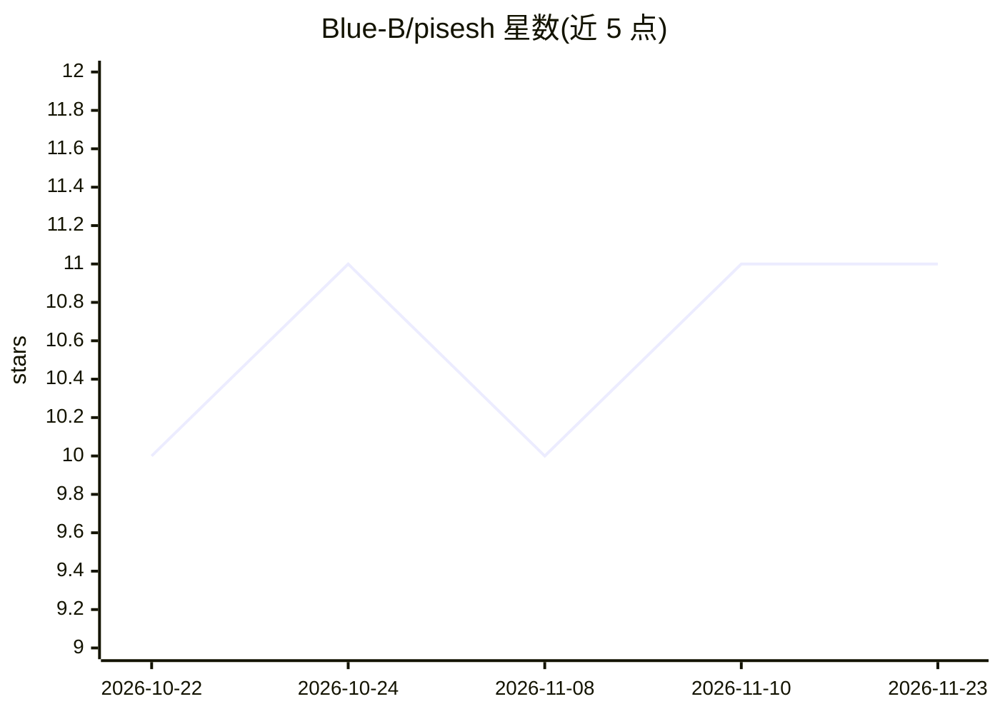

# Blue-B/pisesh

⭐ 11 · JavaScript · MIT · 推送 2026-08-28 · [GitHub](https://github.com/Blue-B/pisesh) · [官网](https://www.npmjs.com/package/pisesh) · 个人维护

**为 pi coding-agent 会话提供书签、搜索与恢复的终端 TUI**

针对 pi 编码代理内置 `--resume` 列表缺少排序与标注的问题，提供键盘驱动的 TUI：收藏（⭐）、Tab 切换 Today/Here/All 标签页、`/` 按 id/项目/首条用户提示/自定义标题搜索、`e` 重命名、`p` 通过目录浏览器改写恢复时的 cwd、`[NOW]` 标记当前会话。单文件 Node 脚本，约 1,600 行、零依赖、无构建步骤；可作为 pi 扩展（`/sesh`，调用 ctx.switchSession()）或独立 CLI 运行。`g` 可调用所选模型生成会话标题，会产生 provider 费用；重命名与 cwd 覆盖存于旁路 JSON，不改写会话文件。

## 筛选速览

| 维度 | 判定 | 备注 |
|---|---|---|
| AI 角色 | `ai-ecosystem` | LLM/agent 周边工具 |
| 许可风险 | `permissive` | MIT |
| 部署形态 | `desktop` | 安装包/桌面程序 |
| 模型依赖 | — | README 未给出锁定关系 |
| 硬件要求 | — | 无带数字的原话,不猜 |
| 安装摩擦 | `medium` | 含编译或系统依赖之一 |
| 成熟度 | — | 结构信号不足 |

## 能力要点

- 单文件 Node 脚本，零依赖、无构建步骤、无原生二进制
- 收藏/自定义标题/cwd 覆盖持久化到旁路 JSON，不触碰会话记录
- 支持在 pi 内通过 /sesh 调用官方 ctx.switchSession() 切换会话
- CJK 显示宽度感知的列对齐渲染

## 适用场景

- 管理数周积累的几十个 pi 会话并快速找回目标线程
- 按当前项目目录过滤仅显示该项目相关会话
- 用脚本（--list/--json/--star）自动化收藏的会话

## 场景标签

 · 领域:开发者工具/终端工具

## 证据(README 行号)

> L11: **Bookmark, search, and resume pi coding-agent sessions with a fast keyboard-driven TUI.**
> L48: pisesh is a **single-file Node script** (no dependencies, ~1,600 LoC) that gives you everything `pi --resume` doesn
> L76: `/sesh` does not start a second pi process. The picker returns the selected session and options to the extension, w

## 星数曲线

2026-10-22 10 → 2026-11-23 11（+1）

---
*卡片 v1 · prompt 1.4 · 生成 2026-11-19 · 置信度 high · 依据 README sha `e6ed5997bc8a` · [字段定义](../../DATASET.md)*
