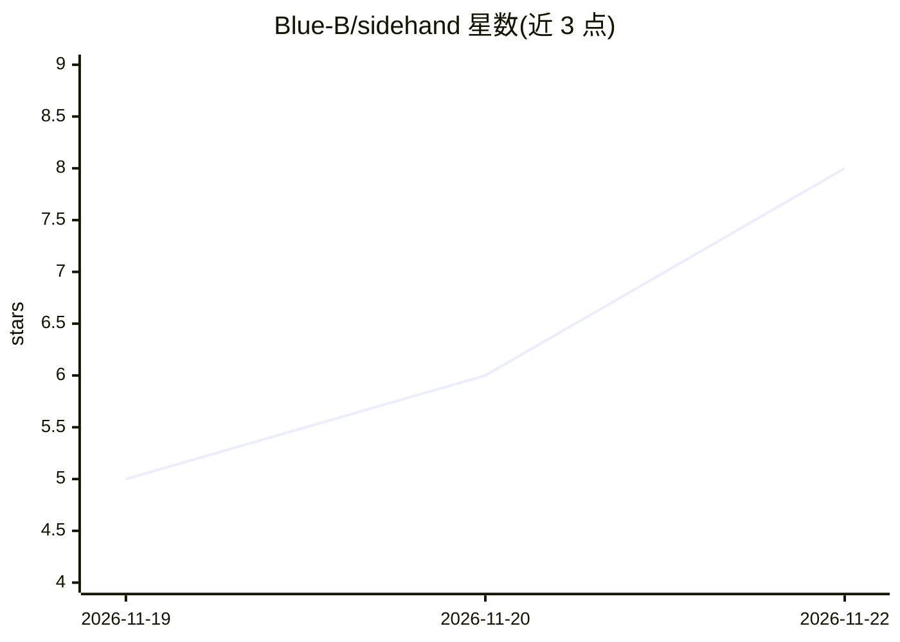

# Blue-B/sidehand

⭐ 8 · PowerShell · NOASSERTION · 推送 2026-11-18 · [GitHub](https://github.com/Blue-B/sidehand) · 个人维护

**让 AI agent 通过 MCP 操作 Windows 应用而不占用键鼠的 MCP server 与 CLI**

Sidehand 以 MCP server 和 CLI 形式提供，使 Claude、Codex、Cursor 等 MCP 客户端读取并操作用户当前窗口背后的 Windows 应用：以文本形式读取窗口控件树，执行输入、点击、选择、滚轮、拖拽等操作，不移动鼠标、不抢夺键盘与前台。对被遮挡窗口可用，另提供基于 Windows OCR 的自绘窗口文本读取、截屏打码（黑色/像素化/模糊）。要求 Windows 10/11 与 Node 18.3+，通过 npx 配置到 MCP 客户端。许可证为 PolyForm Shield 1.0.0，禁止用其构建竞品。

## 筛选速览

| 维度 | 判定 | 备注 |
|---|---|---|
| AI 角色 | `ai-ecosystem` | LLM/agent 周边工具 |
| 许可风险 | `none` | NOASSERTION |
| 部署形态 | `library` | 以包/库形式分发 |
| 模型依赖 | — | README 未给出锁定关系 |
| 硬件要求 | — | 无带数字的原话,不猜 |
| 安装摩擦 | `low` | 无编译、无系统依赖或容器化 |
| 成熟度 | — | 结构信号不足 |

## 能力要点

- 以文本读取窗口控件树，读取消耗约为截图式工具的 1/4 到 1/20
- 在被遮挡的后台窗口执行输入、点击、选择等操作
- 通过 Windows OCR 读取游戏、Qt、canvas 等自绘窗口
- sidehand doctor 检查 Node、WSL、PowerShell、执行策略等环境

## 适用场景

- 让 AI agent 自动填写 Windows 桌面应用中的表单
- 保持前台窗口工作的同时让 agent 在后台应用中执行任务
- 在贴出截图前对邮箱、API key、人脸做打码处理

## 场景标签

`GUI 自动化` · 领域:效率与自动化

## 证据(README 行号)

> L10:  MCP server
> L16: Sidehand lets Claude, Codex, Cursor or any MCP client read and operate Windows apps behind the window you are using

## 星数曲线

2026-11-19 5 → 2026-11-22 8（+3）

---
*卡片 v1 · prompt 1.4 · 生成 2026-11-21 · 置信度 high · 依据 README sha `57480aeb1cec` · [字段定义](../../DATASET.md)*
