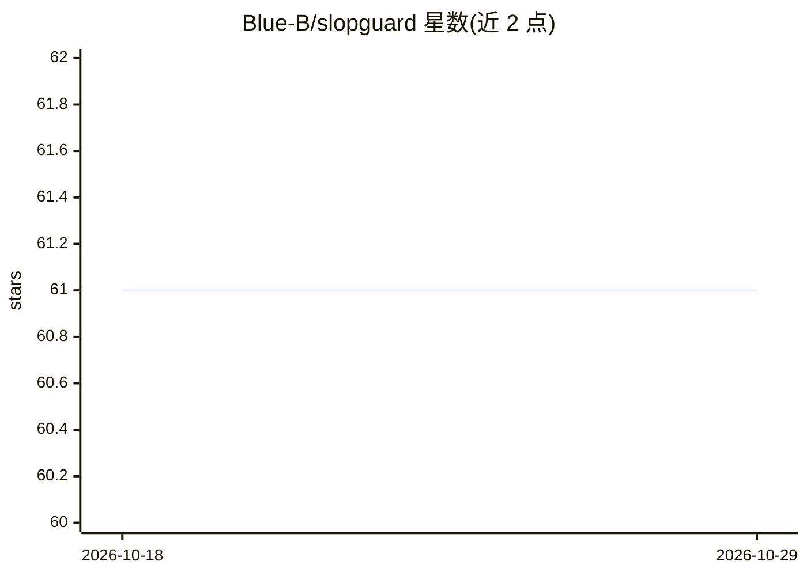

# Blue-B/slopguard

⭐ 61 · TypeScript · NOASSERTION · 推送 2026-10-13 · [GitHub](https://github.com/Blue-B/slopguard) · 个人维护

**GitHub App：给 AI 生成的低质量 PR/issue 评分、溯源并隔离**

面向开源维护者的 GitHub App 与 GitHub Action：webhook 触发后由检测 agent 运行静态启发式与可选 LLM judge，对 PR/issue 打 0–100 分、提取生成器痕迹等溯源信息，打上 slop-quarantine 标签并留评论，最终决定权交由维护者（/slop approve/reject/false-positive 命令，需写权限）。支持无 LLM、零 API key 的纯启发式模式；策略通过 .github/SLOP_POLICY.yml 配置。技术栈为 Next.js + LangGraph + Octokit，无数据库。许可为 MIT 加 Commons Clause 的 source-available，禁止转售或托管服务。

## 筛选速览

| 维度 | 判定 | 备注 |
|---|---|---|
| AI 角色 | `ai-native` | 本体是模型或模型工具 |
| 许可风险 | `none` | NOASSERTION |
| 部署形态 | `library` | 以包/库形式分发 |
| 模型依赖 | — | README 未给出锁定关系 |
| 硬件要求 | — | 无带数字的原话,不猜 |
| 安装摩擦 | `low` | 无编译、无系统依赖或容器化 |
| 成熟度 | — | 结构信号不足 |

## 能力要点

- 启发式 + 可选 LLM judge 的 0–100 评分与溯源标记
- human-in-the-loop：不自动关闭，破坏性操作需维护者显式命令
- 纯启发式模式无需 API key 即可运行
- 公开评测集（golden 25 例 / field 28 例）与混淆矩阵、阈值扫描校准

## 适用场景

- 开源仓库隔离机器生成的低质量 PR 和 issue
- 维护者用 /slop 命令做最终裁决
- 按仓库阈值与标签策略定制检测规则

## 场景标签

`代码审查` · 领域:编码与开发

## 证据(README 行号)

> L14: A GitHub App that triages AI "slop" — low-effort, machine-generated pull requests and issues that waste maintainer 
> L39: A PR or issue triggers a webhook. The detection agent runs static heuristics and (optionally) an LLM judge, extract

## 星数曲线

2026-10-18 61 → 2026-10-29 61（+0）

---
*卡片 v1 · prompt 1.4 · 生成 2026-10-24 · 置信度 high · 依据 README sha `5e659314544a` · [字段定义](../../DATASET.md)*
