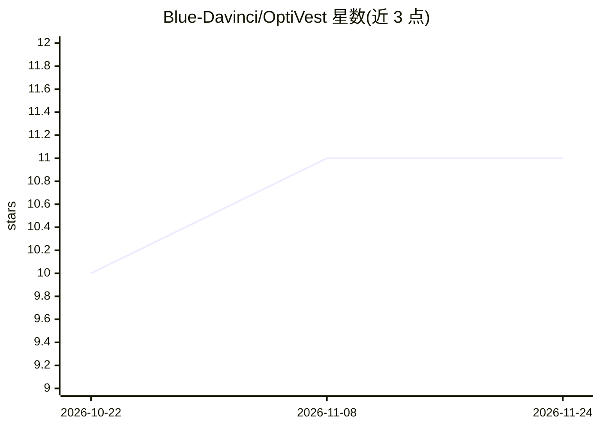

# Blue-Davinci/OptiVest

⭐ 11 · Go · 推送 2026-08-03 · [GitHub](https://github.com/Blue-Davinci/OptiVest) · [官网](https://github.com/Blue-Davinci/OptiVest) · 个人维护

**AI 驱动的个人理财顾问平台后端（Go）**

以 Go 编写的 OptiVest 后端：接入 Alpha Vantage 与 FRED 获取实时金融数据，提供投资组合分析（ROI、Sharpe 比率、行业表现）、基于预训练 AI 模型的个性化投资建议与自动再平衡，以及预算、目标设定、债务追踪工具；另含基于消费/收支数据的预测微服务（需单独部署）、Redis 缓存、WebSocket 实时通知与认证。面向个人理财场景，与前端项目配套使用。安装依赖 Go、PostgreSQL、Redis 与预测微服务，支持源码构建或 docker-compose 启动完整本地栈。

## 筛选速览

| 维度 | 判定 | 备注 |
|---|---|---|
| AI 角色 | `ai-native` | 本体是模型或模型工具 |
| 许可风险 | `none` | — |
| 部署形态 | `desktop` | 安装包/桌面程序 |
| 模型依赖 | — | README 未给出锁定关系 |
| 硬件要求 | — | 无带数字的原话,不猜 |
| 安装摩擦 | `low` | 无编译、无系统依赖或容器化 |
| 成熟度 | — | 结构信号不足 |

## 能力要点

- 接入 Alpha Vantage 与 FRED 提供实时投资组合分析
- 基于预训练 AI 模型生成投资组合再平衡与资产配置建议
- 预测微服务基于收支/债务数据预测未来消费习惯
- docker-compose 一键启动 Postgres+Redis+迁移+API 栈

## 适用场景

- 自动化管理个人投资组合并接收再平衡建议
- 追踪预算、储蓄目标与债务偿还进度
- 基于个人收支数据获得未来消费习惯预测

## 场景标签

`金融量化` · 领域:学习与行业

## 证据(README 行号)

> L27: The OptiVest project is a cutting-edge, AI-driven personal financial advisor platform designed to empower users wit
> L50: 7. **Prediction Capability**
> L51: - Based on your spending, expense, income and debt rates, OptiVest is able to come up with predictions of future ha

## 星数曲线

2026-10-22 10 → 2026-11-24 11（+1）

---
*卡片 v1 · prompt 1.4 · 生成 2026-11-19 · 置信度 high · 依据 README sha `42300c651861` · [字段定义](../../DATASET.md)*
