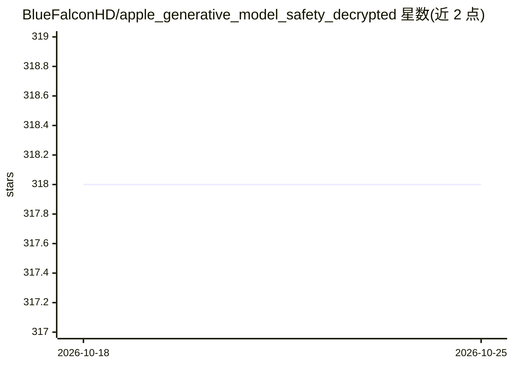

# BlueFalconHD/apple_generative_model_safety_decrypted

⭐ 318 · Python · 推送 2026-07-19 · [GitHub](https://github.com/BlueFalconHD/apple_generative_model_safety_decrypted) · 个人维护

**Apple Intelligence 生成模型安全过滤器的解密数据集与解密脚本**

提供 Apple Intelligence 各生成模型安全过滤器（overrides）的解密 JSON 文件，并附 LLDB 脚本读取加密密钥、解密脚本与按地区/语言合并去重的脚本。解密流程需 Xcode 的 LLDB 附加到 GenerativeExperiencesSafetyInferenceProvider 进程获取密钥，依赖 cryptography 库；仓库内含截至 2025-06-28 的最新解密结果。过滤器含 reject/remove/replace 及对应正则字段，按全局、地区（如 CN）、语言分组，供研究者审查过滤规则范围。

## 筛选速览

| 维度 | 判定 | 备注 |
|---|---|---|
| AI 角色 | `ai-knowledge` | 知识聚合/清单类 |
| 许可风险 | `none` | — |
| 部署形态 | `library` | 以包/库形式分发 |
| 模型依赖 | — | README 未给出锁定关系 |
| 硬件要求 | — | 无带数字的原话,不猜 |
| 安装摩擦 | `low` | 无编译、无系统依赖或容器化 |
| 成熟度 | — | 结构信号不足 |

## 能力要点

- 含已解密的安全过滤器 JSON（更新至 2025-06-28）
- LLDB 脚本获取加密密钥（需 Xcode LLDB）
- 按地区/语言合并去重的元数据脚本（global/region/locale 三层）
- 过滤器含 reject/remove/replace 与正则变体字段

## 适用场景

- 审查 Apple Intelligence 在不同地区的安全过滤规则
- 研究苹果生成模型的输出/输入过滤机制
- 了解模型更新的 overrides 变化并自行解密新版本

## 场景标签

 · 领域:AI 安全/逆向工程

## 证据(README 行号)

> L2: Decrypted Generative Model safety files for Apple Intelligence containing filters
> L12:  - `global_metadata.json`: Combined global safety filters from all models

## 星数曲线

2026-10-18 318 → 2026-10-25 318（+0）

---
*卡片 v1 · prompt 1.4 · 生成 2026-10-21 · 置信度 mid · 依据 README sha `982aff4fc485` · [字段定义](../../DATASET.md)*
