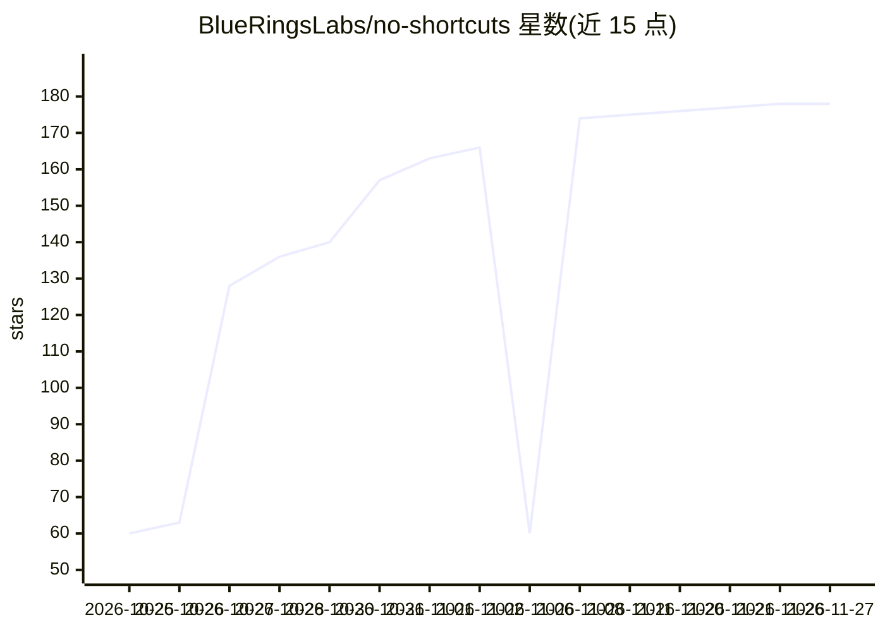

# BlueRingsLabs/no-shortcuts

⭐ 178 · Python · NOASSERTION · 推送 2026-10-28 · [GitHub](https://github.com/BlueRingsLabs/no-shortcuts) · 个人维护

**面向工程师的免费系统化 AI/ML/DL 课程：173 课、166 可运行实验**

由 Gonzalo L. Romero (DeepRat) 编写的免费开源课程，覆盖数据工程、经典机器学习、深度学习、语言模型、AI 工程（RAG/agents/LLM 安全）、强化学习与 MLOps 十大部分，共 173 课、57 模块，附 166 个以普通 Python 文件组织的可运行实验，全部实验经 CI 验证并以断言校验结果。作者将安全（渗透测试视角）贯穿课程：教 RAG 同时教攻击方法。预计约 1,800 小时，目标学员为具备基本编程与高中数学基础、求职数据/AI 工程岗位的学习者，采用 CC BY-NC 4.0 许可。

## 筛选速览

| 维度 | 判定 | 备注 |
|---|---|---|
| AI 角色 | `ai-knowledge` | 知识聚合/清单类 |
| 许可风险 | `none` | NOASSERTION |
| 部署形态 | `library` | 以包/库形式分发 |
| 模型依赖 | — | README 未给出锁定关系 |
| 硬件要求 | — | 无带数字的原话,不猜 |
| 安装摩擦 | `low` | 无编译、无系统依赖或容器化 |
| 成熟度 | — | 结构信号不足 |

## 能力要点

- 十大部分 57 模块 173 课，166 个经 CI 验证的可运行实验
- 实验为普通 Python 文件（# %% 单元），兼容 VS Code/PyCharm/Jupyter
- 安全视角贯穿：讲解 RAG 与数据管道时同步讲授攻击面
- COMPETENCIES.md 将五种岗位所需技能映射到具体课程与实验

## 适用场景

- 系统学习从数学基础到 LLM 工程、MLOps 的完整知识体系
- 求职数据工程师/机器学习工程师/AI 工程师岗位前的能力准备
- 通过带断言的实验以可复现方式学习 PyTorch 与模型训练

## 场景标签

`教程课程` · 领域:学习与行业

## 证据(README 行号)

> L39: Ten parts, 57 modules, 173 lessons. The full catalogue is in SYLLABUS.md.
> L49: |VI. AI Engineering|LLM APIs, prompting, tools, retrieval, RAG, agents, MCP, evals, LLM security|Building products 
> L92: This course is free, and it stays free. It's licensed under Creative Commons Attribution-NonCommercial 4.0 (CC BY-N

## 星数曲线

2026-10-25 60 → 2026-11-27 178（+118）

---
*卡片 v1 · prompt 1.4 · 生成 2026-11-26 · 置信度 high · 依据 README sha `e3c676d344ae` · [字段定义](../../DATASET.md)*
