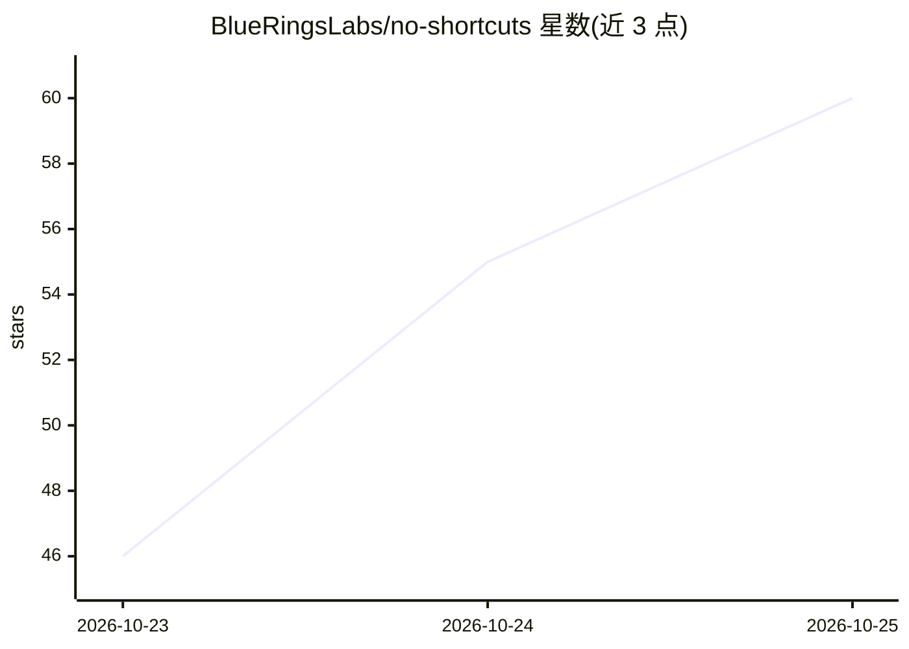

# BlueRingsLabs/no-shortcuts

⭐ 60 · Python · NOASSERTION · 推送 2026-09-26 · [GitHub](https://github.com/BlueRingsLabs/no-shortcuts) · 个人维护

**免费数据/ML/DL/AI 工程课程：173 课 166 实验长线自学**

由个人作者（Gonzalo L. Romero）编写的免费开放课程，覆盖 Python 与数学基础、数据工程、经典 ML、PyTorch 深度学习、语言模型、AI 工程（RAG/agents/MCP/LLM 安全）、强化学习与 MLOps，共 10 部分 57 模块 173 课。每课包含概念、数学推导、代码与生产失效分析；实验为纯 Python 文件、由 CI 执行并带断言校验，用 git clone 加 pip 安装依赖运行，支持转 notebook。许可为 CC BY-NC 4.0，禁止商用。作者预估完整学习约 1,800 小时。

## 筛选速览

| 维度 | 判定 | 备注 |
|---|---|---|
| AI 角色 | `ai-knowledge` | 知识聚合/清单类 |
| 许可风险 | `none` | NOASSERTION |
| 部署形态 | `library` | 以包/库形式分发 |
| 模型依赖 | — | README 未给出锁定关系 |
| 硬件要求 | — | 无带数字的原话,不猜 |
| 安装摩擦 | `low` | 无编译、无系统依赖或容器化 |
| 成熟度 | — | 结构信号不足 |

## 能力要点

- 173 课、166 个可运行实验，全部由 CI 执行校验
- 实验为纯 Python 文件带断言，可经 jupytext 转 notebook
- Part IV 起实验使用冻结课程快照训练小模型并本地缓存
- 覆盖数据工程到 MLOps 与安全攻防的全链路内容

## 适用场景

- 系统自学从数据工程到 AI 工程的完整技能栈
- 按 COMPETENCIES.md 技能映射查漏补缺准备求职
- 在 CPU 或免费 Colab/Kaggle GPU 上动手做实验

## 场景标签

`教程课程` · 领域:学习与行业

## 证据(README 行号)

> L1: # No Shortcuts
> L31: Ten parts, 57 modules, 173 lessons. The full catalogue is in SYLLABUS.md.
> L41: |VI. AI Engineering|LLM APIs, prompting, tools, retrieval, RAG, agents, MCP, evals, LLM security|Building products 

## 星数曲线

2026-10-23 46 → 2026-10-25 60（+14）

---
*卡片 v1 · prompt 1.4 · 生成 2026-10-24 · 置信度 mid · 依据 README sha `4afdaba048a3` · [字段定义](../../DATASET.md)*
