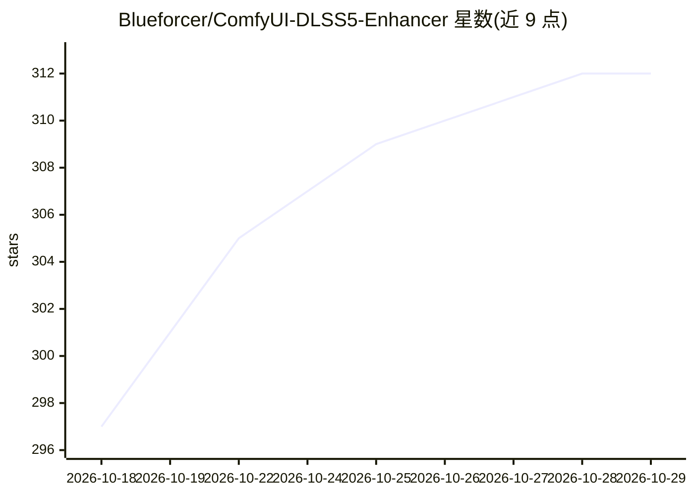

# Blueforcer/ComfyUI-DLSS5-Enhancer

⭐ 312 · Python · NOASSERTION · 推送 2026-09-02 · [GitHub](https://github.com/Blueforcer/ComfyUI-DLSS5-Enhancer) · 个人维护

**ComfyUI 节点包：用 NVIDIA DLSS 5 神经渲染处理图像批次与视频**

面向 ComfyUI 用户的节点包，通过原生 D3D12 进程中托管的 ReShade + RenoDX DLSS 5 运行时（NGX feature 18）对图像批次和视频文件执行神经渲染重建，可选 1.5x–3x 放大。无游戏引擎缓冲，运动向量由 OpenCV DIS 稠密光流估计并在场景切换时重置历史。神经组件（NVIDIA/ReShade/RenoDX 二进制）不在仓库内，由 install_runtime.py 脚本确认许可后从第三方 GitHub releases 下载（约 467MB）。要求 RTX 30 及以上 GPU 与 V3 节点 API 版 ComfyUI；视频节点另需 ffmpeg/ffprobe。提供 Settings、Enhance Images、Enhance Video File 三个节点。

## 筛选速览

| 维度 | 判定 | 备注 |
|---|---|---|
| AI 角色 | `ai-native` | 本体是模型或模型工具 |
| 许可风险 | `none` | NOASSERTION |
| 部署形态 | `desktop` | 安装包/桌面程序 |
| 模型依赖 | — | README 未给出锁定关系 |
| 硬件要求 | — | 无带数字的原话,不猜 |
| 安装摩擦 | `medium` | 含编译或系统依赖之一 |
| 成熟度 | — | 结构信号不足 |

## 能力要点

- 将 DLSS 5 神经渲染以 NGX feature 18 形式接入 ComfyUI 工作流
- 图像批次与视频文件两种节点，视频路径解码/渲染/编码并发流水线
- OpenCV DIS 光流估计运动向量，场景切换自动重置时序历史
- 模型预设 J/K/L/M 等参数控制，附实测推荐设置表

## 适用场景

- 清理并增强 AI 生成视频的皮肤、毛发与织物材质细节
- 对视频做 1.5x–3x 放大同时进行神经渲染增强
- 在 ComfyUI 工作流中以节点形式批量处理图像序列

## 场景标签

`图像视频处理` · 领域:感知与多模态

## 证据(README 行号)

> L3: Run NVIDIA DLSS 5 Neural Rendering over your frames and videos, inside ComfyUI.
> L8: drives that same renderer over video frames and image batches, with optional 1.5x to 3x upscaling.
> L24: There is no Python API for any of it. The renderer lives in a native D3D12 process that hosts
> L25: ReShade and the RenoDX DLSS 5 add-on and evaluates NGX feature 18. This node pack implements the

## 星数曲线

2026-10-18 297 → 2026-10-29 312（+15）

---
*卡片 v1 · prompt 1.4 · 生成 2026-10-21 · 置信度 mid · 依据 README sha `81bded5a7d63` · [字段定义](../../DATASET.md)*
