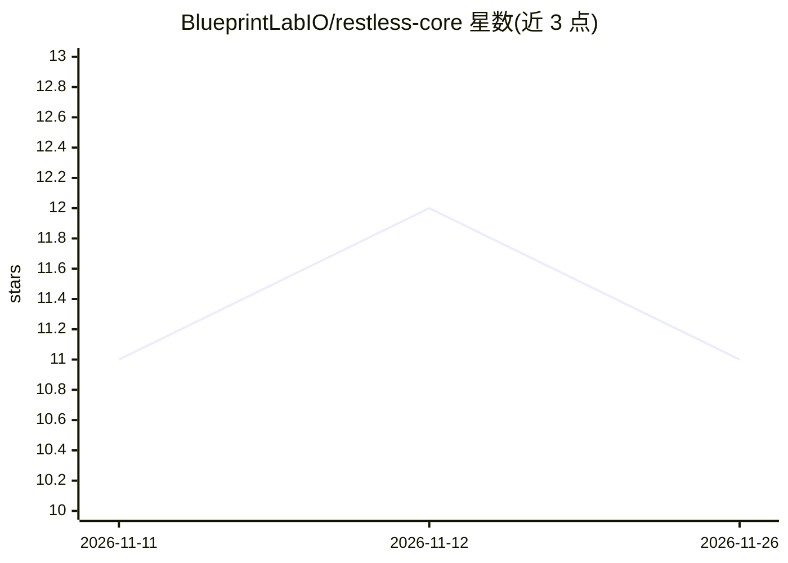

# BlueprintLabIO/restless-core

⭐ 11 · Rust · Apache-2.0 · 推送 2026-11-21 · [GitHub](https://github.com/BlueprintLabIO/restless-core) · [官网](https://restless.run) · 组织维护

**面向人类与 AI agent 协作的自托管工作空间**

自托管（Apache 2.0）的多 agent 协作平台：提供房间聊天、实时协作文档（Tiptap/Yjs/Hocuspocus）、工作看板和一台持久化 Linux 工作机（文件、Git、浏览器、可接管桌面）。组织机制 OrgIntel 用 Exec/lead/worker 分层保持目标与归属，支持换模型、重启会话后工作延续，配预算、金库与外部操作审计，并将需要人的判断汇集为待决事项。面向以团队形式与 agent 协作的小组；当前为 development preview，运行于用户自有 Linux 机器。

## 筛选速览

| 维度 | 判定 | 备注 |
|---|---|---|
| AI 角色 | `ai-native` | 本体是模型或模型工具 |
| 许可风险 | `permissive` | Apache-2.0 |
| 部署形态 | `self-host` | docker 或自建部署 |
| 模型依赖 | — | README 未给出锁定关系 |
| 硬件要求 | — | 无带数字的原话,不猜 |
| 安装摩擦 | `low` | 无编译、无系统依赖或容器化 |
| 成熟度 | `idea` | |

## 能力要点

- 房间、协作文档、工作看板与持久 Linux 工作机一体化工作空间
- OrgIntel 分层：Exec 持有优先级、lead 负责结果、worker 生产
- 目标跨会话存活：可换模型、重启会话或交接工作
- 按 agent 授权、预算与外部操作记录控制权限

## 适用场景

- 让多人团队与多个 agent 在同一工作空间共担任务
- 把构建、导出、调研等杂务交给 agent，人只处理关键决策
- 在自有服务器上自托管一套人机协作办公室
- 管理可跨会话延续的长期目标与工作交接

## 场景标签

`多智能体` · 领域:Agent 开发

## 证据(README 行号)

> L9: Restless gives your team and its agents one place to work: rooms, shared documents, a board
> L63: Restless agents run on Codex, Claude Code or an API model. The difference is the structure
> L96: OrgIntel (organisational intelligence) is what lets the company carry work forward after a

## 星数曲线

2026-11-11 11 → 2026-11-26 11（+0）

---
*卡片 v1 · prompt 1.4 · 生成 2026-11-18 · 置信度 mid · 依据 README sha `707745b35f31` · [字段定义](../../DATASET.md)*
