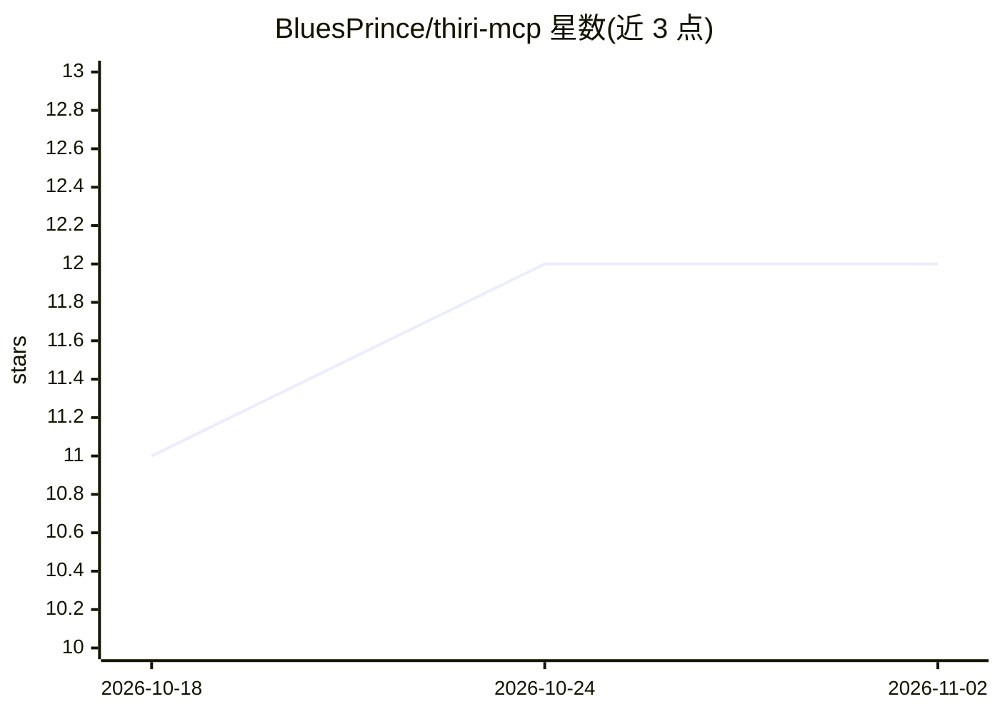

# BluesPrince/thiri-mcp

⭐ 12 · JavaScript · NOASSERTION · 推送 2026-10-28 · [GitHub](https://github.com/BluesPrince/thiri-mcp) · [官网](https://mcp.thiri.ai) · 组织维护

**确定性音乐理论 MCP 服务器与 API：为 AI agent 提供和弦分析/重配**

面向 AI 构建者的托管式音乐理论 MCP 服务器与 REST API：基于音级集合理论（ℤ/12）的确定性引擎，提供和弦分析（根音/音质/罗马数字/和声功能）、和弦解析、多种排列法配 voicing 与声部进行评分、8 种技法重配和弦，以及自然语言乐队指挥（conduct_band）。支持 Claude/Cursor 等 MCP 客户端经托管连接器或 npx 本地接入，亦可直接调用 REST API。桌面端附加本地 conductor/composition MCP 二进制可服务端渲染音频。License 为 PolyForm Noncommercial 1.0.0，非商业免费。

## 筛选速览

| 维度 | 判定 | 备注 |
|---|---|---|
| AI 角色 | `ai-ecosystem` | LLM/agent 周边工具 |
| 许可风险 | `none` | NOASSERTION |
| 部署形态 | `library` | 以包/库形式分发 |
| 模型依赖 | — | README 未给出锁定关系 |
| 硬件要求 | — | 无带数字的原话,不猜 |
| 安装摩擦 | `low` | 无编译、无系统依赖或容器化 |
| 成熟度 | — | 结构信号不足 |

## 能力要点

- 确定性引擎输出罗马数字分析、拼写正确的和弦音与 voicing（每次结果一致）
- reharmonize 提供 8 种重配技法（tritone_sub、coltrane_changes 等）
- 托管连接器一键接入，或 npx 本地运行，另提供 5 个 REST 端点
- 本地 conductor MCP 支持服务端 Csound 渲染 WAV 并本地播放

## 适用场景

- 让 Claude/Cursor 等 agent 准确分析爵士和弦进行与罗马数字
- 对生成器（如 Suno/Udio）输出的和弦做确定性校验与重配
- 通过对话指挥虚拟乐队并渲染音频

## 场景标签

 · 领域:音乐/Agent 工具

## 证据(README 行号)

> L10: **Give your AI real music theory.** THIRI is the deterministic **music theory MCP server + API** for AI builders — 
> L12: LLMs hallucinate music theory: wrong notes, fake roman numerals, voicings that don't voice-lead. THIRI is a **deter

## 星数曲线

2026-10-18 11 → 2026-11-02 12（+1）

---
*卡片 v1 · prompt 1.4 · 生成 2026-11-01 · 置信度 high · 依据 README sha `3878f681fbe8` · [字段定义](../../DATASET.md)*
