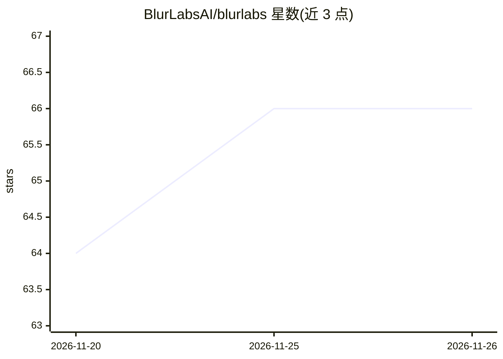

# BlurLabsAI/blurlabs

⭐ 66 · Python · GPL-3.0 · 推送 2026-11-04 · [GitHub](https://github.com/BlurLabsAI/blurlabs) · [官网](https://www.blurlabs.ai/ram2) · 组织维护

**面向成像研究者的通用图像重建基础模型（RAM 2）**

Blur Labs 开源的计算成像重建模型仓库。RAM 2（359M 参数）输入测量数据、采集物理算子与噪声水平，输出重建图像，覆盖去噪、去模糊、超分辨率、PET、超声、多线圈 MRI、CT 等 2D 成像任务，无需按任务重训练。权重经 Hugging Face 门控下载，依赖 DeepInverse 提供的成像算子。RAM 2 权重采用 GPL-3.0，商业许可需联系厂商；内置训练条件外输入的调试提示机制。

## 筛选速览

| 维度 | 判定 | 备注 |
|---|---|---|
| AI 角色 | `ai-native` | 本体是模型或模型工具 |
| 许可风险 | `dual` | GPL-3.0 |
| 部署形态 | `library` | 以包/库形式分发 |
| 模型依赖 | — | README 未给出锁定关系 |
| 硬件要求 | — | 无带数字的原话,不猜 |
| 安装摩擦 | `low` | 无编译、无系统依赖或容器化 |
| 成熟度 | — | 结构信号不足 |

## 能力要点

- 单一网络处理多种 2D 成像重建任务，无需逐任务重训练
- 支持去噪、去模糊、超分辨率、CT、多线圈 MRI、PET 等算子
- 可报告算子范数、噪声水平并标记训练条件外的输入
- 可用作 DeepInverse 示例的直接替换模型

## 适用场景

- 对运动模糊的摄影或显微图像做重建
- 做稀疏视角断层或卫星图像去噪实验
- 做多线圈 MRI 重建研究

## 场景标签

`图像视频处理` · 领域:感知与多模态

## 证据(README 行号)

> L3: > Foundation models for computational imaging from Blur Labs: one network that reconstructs images from the measurem
> L10: the reconstructed image.

## 星数曲线

2026-11-20 64 → 2026-11-26 66（+2）

---
*卡片 v1 · prompt 1.4 · 生成 2026-11-20 · 置信度 high · 依据 README sha `3ea512e3ea46` · [字段定义](../../DATASET.md)*
