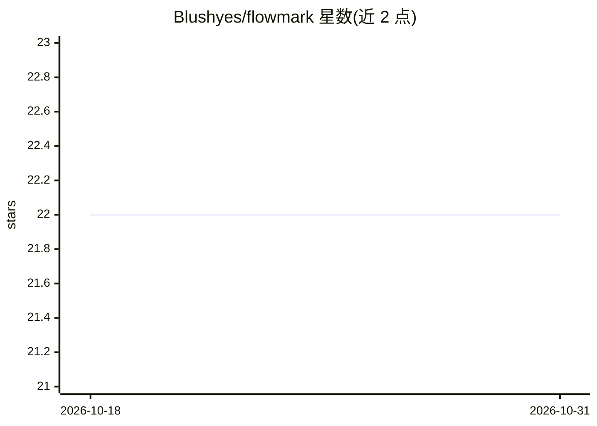

# Blushyes/flowmark

⭐ 22 · TypeScript · 推送 2026-03-14 · [GitHub](https://github.com/Blushyes/flowmark) · [官网](https://chromewebstore.google.com/detail/kbmjedeepcglnmllaklecppgijhgggdg?utm_source=item-share-cb) · 个人维护 · 中文 README

**保存网页时由 AI 建议书签文件夹、标题与摘要的浏览器扩展**

基于 WXT、SolidJS 与 Tailwind CSS 的浏览器扩展：用户创建书签后读取轻量页面上下文，经页面质量过滤（登录页/搜索结果/低信息页），调用用户配置的 OpenAI 兼容端点（通过 Vercel AI SDK）生成文件夹、标题、一句话摘要与置信度，以浮层胶囊形式供接受、拒绝、倒计时自动应用或删除。含重复书签检测与合并提示，默认自动接受延迟 5 秒、不发送全文。面向需要自动整理书签的浏览器用户，提供中英文 UI。

## 筛选速览

| 维度 | 判定 | 备注 |
|---|---|---|
| AI 角色 | `ai-enhanced` | 去掉 AI 部分产品仍成立 |
| 许可风险 | `none` | — |
| 部署形态 | `library` | 以包/库形式分发 |
| 模型依赖 | — | README 未给出锁定关系 |
| 硬件要求 | — | 无带数字的原话,不猜 |
| 安装摩擦 | `low` | 无编译、无系统依赖或容器化 |
| 成熟度 | — | 结构信号不足 |

## 能力要点

- 书签保存后 AI 建议文件夹、标题、一句话摘要与置信度
- 兼容任意 OpenAI 兼容端点（Vercel AI SDK）
- 登录页/搜索结果/低信息页质量过滤与警告
- 重复书签检测与合并提示

## 适用场景

- 收藏网页时自动归类到合适文件夹并规范标题
- 在弹出页查看当前页面的一句话摘要
- 拦截和清理登录页、搜索结果等低价值书签

## 场景标签

`知识库管理` · 领域:知识与检索

## 证据(README 行号)

> L5: FlowMark is a browser extension that recommends a better bookmark folder and title right after you save a page.
> L12: - Works with any OpenAI-compatible endpoint through Vercel AI SDK
> L25: 4. asks the configured AI model for a folder, title, one-sentence summary, and confidence score when the page passe

## 星数曲线

2026-10-18 22 → 2026-10-31 22（+0）

---
*卡片 v1 · prompt 1.4 · 生成 2026-10-28 · 置信度 high · 依据 README sha `3a69175c4177` · [字段定义](../../DATASET.md)*
