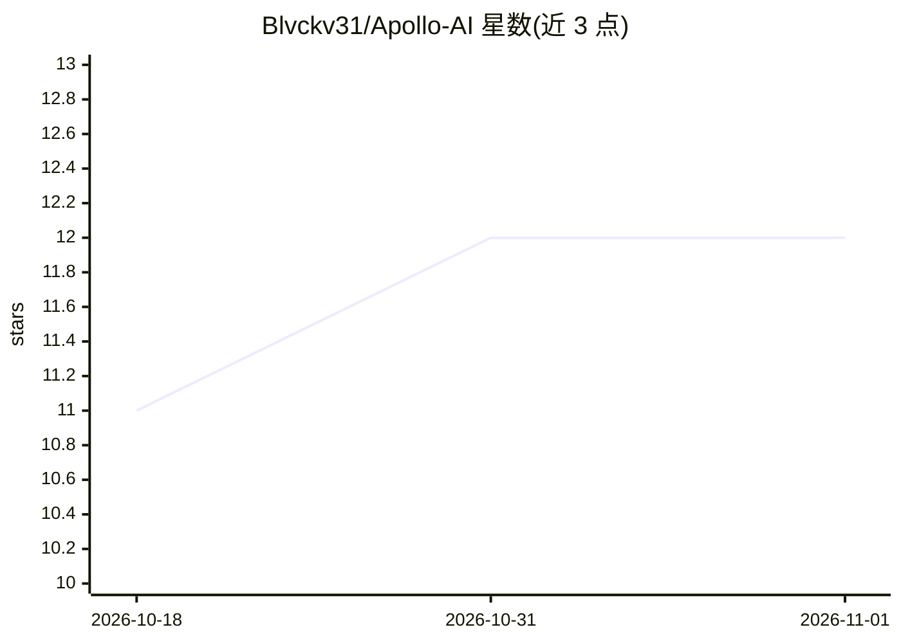

# Blvckv31/Apollo-AI

⭐ 12 · Jupyter Notebook · 推送 2026-08-26 · [GitHub](https://github.com/Blvckv31/Apollo-AI) · [官网](https://omkarvatsa.hashnode.dev/lofi-music-generator) · 个人维护

**基于 RNN/LSTM 的音乐生成模型（学习乐曲数据集后作曲）**

一个使用循环神经网络（LSTM）从乐曲数据集中学习并生成音乐的项目。README 主要内容为概念说明：解释 RNN、LSTM 的原理，介绍所用的工具（Keras 作为 TensorFlow 的高层 API、Music21 处理乐理），并讲解音符、和弦、音高、八度、偏移等音乐术语，示例目标为生成 Lofi Hip Hop 风格乐曲。README 未见安装命令、运行方式或数据集获取说明，仅展示 AI 生成歌曲的链接。

## 筛选速览

| 维度 | 判定 | 备注 |
|---|---|---|
| AI 角色 | `ai-native` | 本体是模型或模型工具 |
| 许可风险 | `none` | — |
| 部署形态 | `None` |  |
| 模型依赖 | — | README 未给出锁定关系 |
| 硬件要求 | — | 无带数字的原话,不猜 |
| 安装摩擦 | `low` | 无编译、无系统依赖或容器化 |
| 成熟度 | — | 结构信号不足 |

## 能力要点

- 使用 RNN/LSTM 从乐曲数据集学习并生成音乐
- 使用 Music21 工具包处理音乐理论与乐曲表示
- 基于 Keras/TensorFlow 构建网络
- 示例目标为生成 Lofi Hip Hop 风格乐曲

## 适用场景

- 学习如何用 LSTM 网络生成音乐
- 生成 Lofi Hip Hop 风格的乐曲片段

## 场景标签

`教程课程` · 领域:学习与行业

## 证据(README 行号)

> L3: An AI model capable of generating music after learning on an extensive dataset of songs provided to the recurrent ne
> L9: 1. **Recurrent Neural Networks (RNN):** A recurrent neural network is a class of artificial neural networks that mak
> L13: 3. **Music21:** A Python toolkit used for computer-aided musicology. It allows us to teach the fundamentals of musi

## 星数曲线

2026-10-18 11 → 2026-11-01 12（+1）

---
*卡片 v1 · prompt 1.4 · 生成 2026-11-01 · 置信度 mid · 依据 README sha `f9ec1db2b87b` · [字段定义](../../DATASET.md)*
