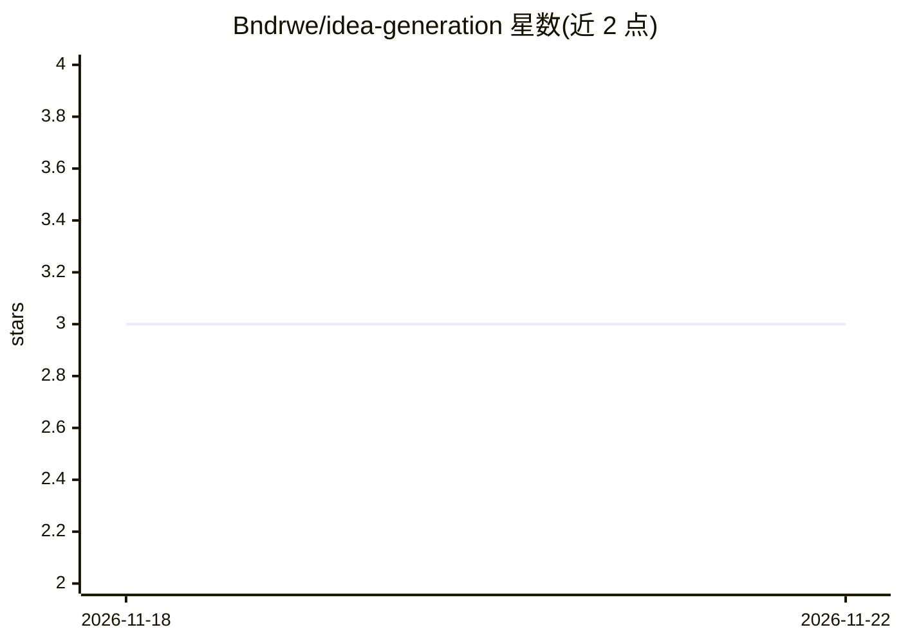

# Bndrwe/idea-generation

⭐ 3 · Python · MIT · 推送 2026-11-21 · [GitHub](https://github.com/Bndrwe/idea-generation) · 个人维护

**给 Claude/Codex 用户的反套路创意生成技能**

一个面向 Claude 与 OpenAI Codex 的技能包：先写出常见答案并封禁（cliché wall），在二维地图上展开生成，用本地嵌入模型（all-MiniLM-L6-v2，约 80 MB，CPU 运行）做向量化查重，再经怀疑式评审与入围筛选后输出。支持商业、研究、文章、故事等四类创意，各有不同的可行性判据。嵌入环境不可用时回退到基于词汇的检查。按 idea 类型（business/research/essay/story）划分 payoff test 与评审角色；本地嵌入模型约 80 MB，CPU 运行，无需 API key；README 附三轮版本对比测试数据并声明样本量小。

## 筛选速览

| 维度 | 判定 | 备注 |
|---|---|---|
| AI 角色 | `ai-native` | 本体是模型或模型工具 |
| 许可风险 | `permissive` | MIT |
| 部署形态 | `library` | 以包/库形式分发 |
| 模型依赖 | locked-api |  |
| 硬件要求 | — | 无带数字的原话,不猜 |
| 安装摩擦 | `low` | 无编译、无系统依赖或容器化 |
| 成熟度 | — | 结构信号不足 |

## 能力要点

- 八步流程：封禁陈词清单→地图生成→向量查重→怀疑式评审→入围与展示
- 本地嵌入查重（all-MiniLM-L6-v2），无需 API key，数据不出本机
- 无代码环境自动回退到词汇概率检查（NO_EMBEDDINGS）
- 支持 Claude.ai、Claude Code 与 Codex 三种安装方式

## 适用场景

- 想要避开常见答案的副项目/商业点子
- 为研究寻找可检验的新问题
- 为文章或演讲挑选非常规选题

## 场景标签

`提示工程` · 领域:Agent 开发

## 证据(README 行号)

> L3: A Claude and OpenAI Codex skill for brainstorming ideas that are unusual and still workable. The ideas can be anythi
> L17: The eight steps: pin the brief, write the cliché wall, draw a map and generate ideas, then the vector check, a skep

## 星数曲线

2026-11-18 3 → 2026-11-22 3（+0）

---
*卡片 v1 · prompt 1.4 · 生成 2026-11-22 · 置信度 mid · 依据 README sha `01a551db3bdf` · [字段定义](../../DATASET.md)*
