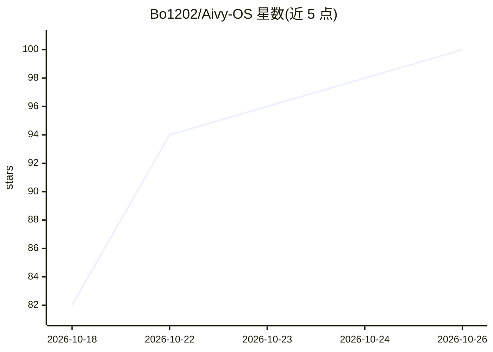

# Bo1202/Aivy-OS

⭐ 100 · NOASSERTION · 推送 2026-10-24 · [GitHub](https://github.com/Bo1202/Aivy-OS) · 个人维护 · 中文 README

**Windows 本地 AI 伙伴软件：会聊会听能操作电脑且持久记忆**

装在 Windows 上的桌面 AI 伙伴应用，面向普通用户而非插件或开发库：支持语音对话、屏幕/窗口/控件操作、文件读写、跑程序、内置浏览器网页操作、IDE 代码工作区、子智能体并行任务、定时主动任务与知识库笔记，对话与记忆保存在本机（%LOCALAPPDATA%\AivyOS）。可切换 DeepSeek、通义千问、Kimi、智谱、OpenAI、Gemini、Claude 及 Ollama 本地模型等，支持 MCP 与插件。仅以 Releases 的 .exe 安装包分发，商业软件许可，首次使用需模型 API Key 或本机 Ollama。

## 筛选速览

| 维度 | 判定 | 备注 |
|---|---|---|
| AI 角色 | `ai-native` | 本体是模型或模型工具 |
| 许可风险 | `none` | NOASSERTION |
| 部署形态 | `desktop` | 安装包/桌面程序 |
| 模型依赖 | local-ok | 支持本地模型 |
| 硬件要求 | — | 无带数字的原话,不猜 |
| 安装摩擦 | `low` | 无编译、无系统依赖或容器化 |
| 成熟度 | — | 结构信号不足 |

## 能力要点

- 持久记忆：对话按语义/时间检索，用户画像单独存储
- 屏幕/控件级桌面自动化与内置浏览器网页操作
- 多厂商模型随时切换，含 Ollama 本地模型与 OpenAI 兼容接口
- 改动可撤回、后台任务、子智能体并行与定时主动任务

## 适用场景

- 让 AI 直接在电脑上替我整理文件、操作软件和网页
- 用语音自然对话并交代任务，本地保存对话和记忆
- 离线使用本地 Ollama 模型保护隐私

## 场景标签

`AI 助手` `GUI 自动化` `浏览器自动化` `语音 Agent` · 领域:效率与自动化

## 证据(README 行号)

> L15: Aivy OS 是装在 Windows 上的 AI 伙伴。她能陪你聊天、听你说话，也能真正动手：读写文件、跑程序、操作软件和网页。她有自己的性格，记得和你一起做过的事。对话和记忆都保存在你自己的电脑上。
> L83: DeepSeek、通义千问、Kimi、智谱、OpenAI、Gemini、Claude、Ollama 本地模型，以及任意 OpenAI 兼容接口。对话框旁边随时切换：正在回答的这一轮用原来的模型做完，下一句就用新的。

## 星数曲线

2026-10-18 82 → 2026-10-26 100（+18）

---
*卡片 v1 · prompt 1.4 · 生成 2026-10-23 · 置信度 high · 依据 README sha `45cfed48b749` · [字段定义](../../DATASET.md)*
