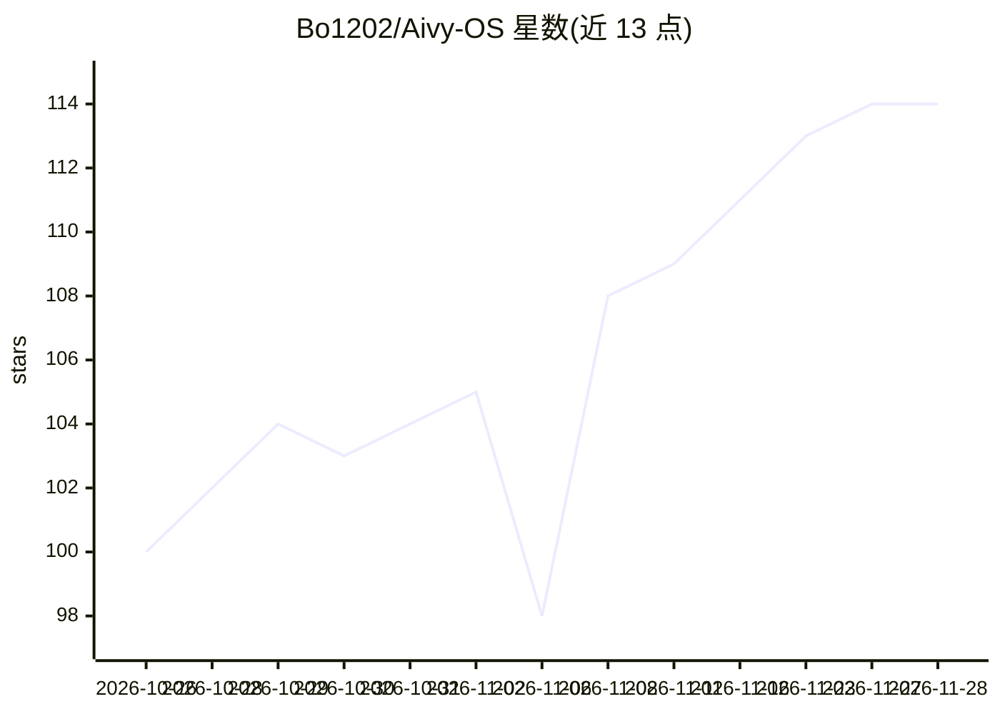

# Bo1202/Aivy-OS

⭐ 114 · NOASSERTION · 推送 2026-11-19 · [GitHub](https://github.com/Bo1202/Aivy-OS) · 个人维护 · 中文 README

**Windows 桌面 AI 伙伴：聊天记忆加文件与软件操作**

面向 Windows 桌面用户的 AI 伙伴软件：语音对话、持久记忆与用户画像、屏幕/控件操作、内置浏览器、代码工作区、定时任务、员工 BOT 团队（五位常驻可扩展至 20 位）、MCP 外部工具接入。仓库仅含说明文档，程序以 Releases 的 .exe 安装包分发；需配置任一模型服务商 API Key 或本机 Ollama。商业软件，数据存本机。

## 筛选速览

| 维度 | 判定 | 备注 |
|---|---|---|
| AI 角色 | `ai-native` | 本体是模型或模型工具 |
| 许可风险 | `none` | NOASSERTION |
| 部署形态 | `desktop` | 安装包/桌面程序 |
| 模型依赖 | local-ok | 支持本地模型 |
| 硬件要求 | — | 无带数字的原话,不猜 |
| 安装摩擦 | `low` | 无编译、无系统依赖或容器化 |
| 成熟度 | — | 结构信号不足 |

## 能力要点

- 读屏幕、认控件、操作任意软件与网页，并读回核对结果
- 对话与记忆存本机，支持 Ollama 本地模型离线运行
- 五位常驻员工 BOT 团队，可自建员工并分配 MCP 工具
- 支持多家厂商模型随时切换及 OpenAI 兼容接口

## 适用场景

- 一句话整理文件、跑命令、操作办公软件
- 带持久记忆的日常语音陪伴与提醒
- 对话式改代码、跑测试的本地工作区
- 接入企业微信后远程交代任务

## 场景标签

`AI 助手` `GUI 自动化` `浏览器自动化` `编码 Agent` · 领域:效率与自动化

## 证据(README 行号)

> L15: Aivy OS 是装在 Windows 上的 AI 伙伴。她能陪你聊天、听你说话，也能真正动手：读写文件、跑程序、操作软件和网页。她有自己的性格，记得和你一起做过的事。对话和记忆都保存在你自己的电脑上。
> L81: DeepSeek、通义千问、Kimi、智谱、OpenAI、Gemini、Claude、Ollama 本地模型，以及任意 OpenAI 兼容接口。对话框旁边随时切换：正在回答的这一轮用原来的模型做完，下一句就用新的。
> L91: 1. **下载安装**：从 Releases 下载 `Aivy OS Setup 2.6.6.exe`（页面上显示为 `Aivy.OS.Setup.2.6.6.exe`），双击安装。

## 星数曲线

2026-10-26 100 → 2026-11-28 114（+14）

---
*卡片 v1 · prompt 1.4 · 生成 2026-11-28 · 置信度 high · 依据 README sha `2b22824a8a22` · [字段定义](../../DATASET.md)*
