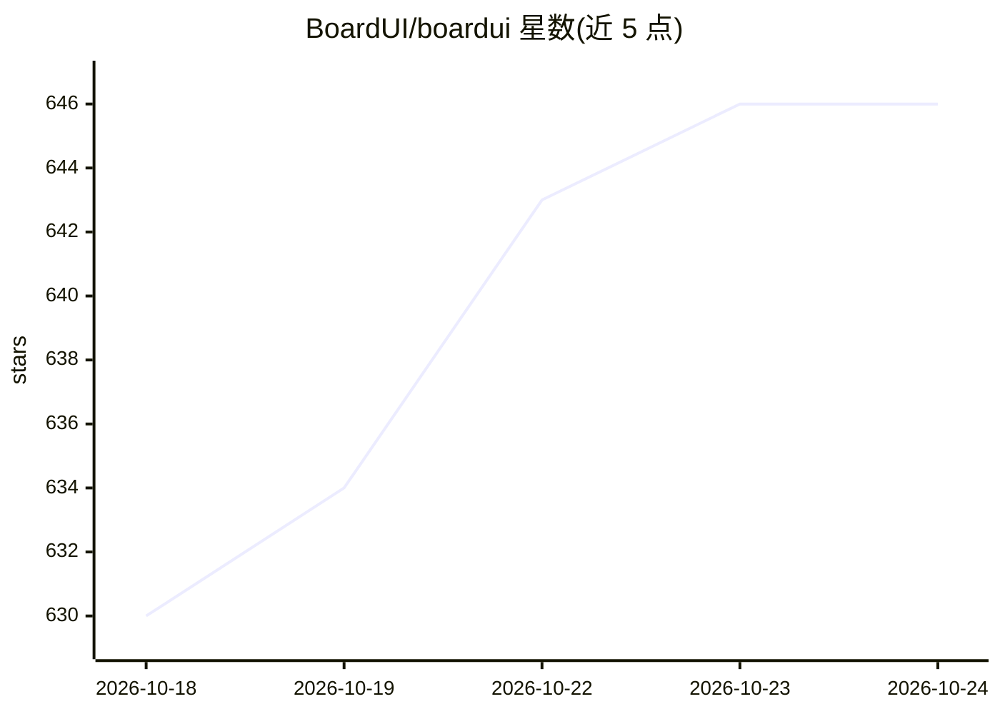

# BoardUI/boardui

⭐ 646 · TypeScript · MIT · 推送 2026-10-02 · [GitHub](https://github.com/BoardUI/boardui) · [官网](https://www.boardui.com) · 组织维护

**面向 AI 产品的 React 组件设计系统，含自带模型 Key 的聊天应用首页**

面向 agent 产品的 React 设计系统：以源码形式将 69 个免费组件（Agent Chat、Agent Log、思考指示器、数据表格、侧栏等）复制进用户项目，基于 React Aria Components 与 Tailwind CSS v4，提供 400+ 语义 token、明暗主题与 RTL（阿拉伯语/希伯来语）支持。仓库首页是一个自带 API Key（BYOK）即可运行的 AI 聊天应用：服务端读取 Key 并流式返回，按 Key 前缀识别 Anthropic/OpenRouter/OpenAI/Groq/xAI 等提供商，也支持任意 OpenAI 兼容服务（Ollama/vLLM 等）。另提供 MCP server、CLI（npx boardui add）与 agent 安装规则。本仓库为免费层，不接受 PR。

## 筛选速览

| 维度 | 判定 | 备注 |
|---|---|---|
| AI 角色 | `ai-ecosystem` | LLM/agent 周边工具 |
| 许可风险 | `permissive` | MIT |
| 部署形态 | `library` | 以包/库形式分发 |
| 模型依赖 | local-ok | 支持本地模型 |
| 硬件要求 | — | 无带数字的原话,不猜 |
| 安装摩擦 | `low` | 无编译、无系统依赖或容器化 |
| 成熟度 | — | 结构信号不足 |

## 能力要点

- 69 个免费组件以源码形式复制进项目（npx boardui add），非 npm 依赖
- 首页为 BYOK 的可运行 AI 聊天应用，按 Key 前缀识别 7 类提供商，Key 仅存服务端
- MCP server + AGENTS.md 规则，供 Claude Code/Cursor 等 coding agent 直接安装组件
- RTL 方向感知布局与 React Aria 无障碍组件

## 适用场景

- 为 AI/agent 产品快速搭建聊天、侧栏、数据表格等界面
- 一键部署一个用自己模型 Key 的聊天应用作为产品首页
- 让 coding agent 通过 MCP 按需安装和接线组件

## 场景标签

`聊天机器人` · 领域:对话与助手

## 证据(README 行号)

> L11: BoardUI is a React design system for agentic interfaces: the parts an AI product needs and the parts every dashboar
> L21: - **Built for agent products.** Chat, thinking indicator, agent log, composer and sidebar, next to the tables, card
> L26: - **Agent-native.** MCP server, agent skill, `AGENTS.md` rules and `llms.txt`, so coding agents build with the syst

## 星数曲线

2026-10-18 630 → 2026-10-24 646（+16）

---
*卡片 v1 · prompt 1.4 · 生成 2026-10-21 · 置信度 high · 依据 README sha `8b36c0d20c77` · [字段定义](../../DATASET.md)*
