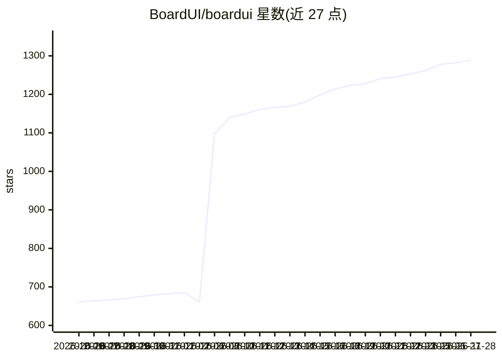

# BoardUI/boardui

⭐ 1,289 · TypeScript · MIT · 推送 2026-11-26 · [GitHub](https://github.com/BoardUI/boardui) · [官网](https://www.boardui.com) · 组织维护

**面向 AI Agent 界面的 React 设计系统，组件以源码形式安装**

BoardUI 为 AI 产品提供 React 组件库：Agent 聊天、思考指示器、Agent 日志、输入框等界面部件与数据表格、卡片、表单等常规仪表盘部件共用一套视觉语言，以源码文件形式复制进用户项目而非作为依赖包引入。仓库含 90 个免费组件、一个自托管聊天应用首页（读取用户自己的模型密钥、服务端流式回复、聊天记录存浏览器）以及 MCP server 和 agent skill，支持 Claude Code、Cursor 等编码代理自动浏览目录并安装组件。底层基于 React Aria Components 与 Tailwind CSS v4，支持 RTL 布局。

## 筛选速览

| 维度 | 判定 | 备注 |
|---|---|---|
| AI 角色 | `ai-enhanced` | 去掉 AI 部分产品仍成立 |
| 许可风险 | `permissive` | MIT |
| 部署形态 | `library` | 以包/库形式分发 |
| 模型依赖 | local-ok | 支持本地模型 |
| 硬件要求 | — | 无带数字的原话,不猜 |
| 安装摩擦 | `low` | 无编译、无系统依赖或容器化 |
| 成熟度 | — | 结构信号不足 |

## 能力要点

- 90 个免费组件以源码形式通过 npx boardui add 复制进项目
- 内置 MCP server、agent skill 与 AGENTS.md 规则，供编码代理构建界面
- BYO-key 聊天应用：密钥仅服务端读取，按密钥前缀自动识别供应商
- RTL 支持：阿拉伯语、希伯来语等从右到左布局与键盘导航

## 适用场景

- 为 AI Agent 产品搭建聊天与仪表盘界面
- 让 Claude Code/Cursor 等编码代理自动安装并按设计规范写组件
- 用自有 API 密钥部署一个无数据库的自托管聊天页
- 构建阿拉伯语/希伯来语等 RTL 界面

## 场景标签

 · 领域:前端开发/UI 组件

## 证据(README 行号)

> L11: BoardUI is a React design system for agentic interfaces: the parts an AI product needs and the parts every dashboar
> L22: - **Source, not a dependency.** `npx boardui add` copies the files into your project. Change anything.
> L26: - **Agent-native.** MCP server, agent skill, `AGENTS.md` rules and `llms.txt`, so coding agents build with the syst

## 星数曲线

2026-10-26 661 → 2026-11-28 1,289（+628）

---
*卡片 v1 · prompt 1.4 · 生成 2026-11-27 · 置信度 mid · 依据 README sha `9605c957b134` · [字段定义](../../DATASET.md)*
