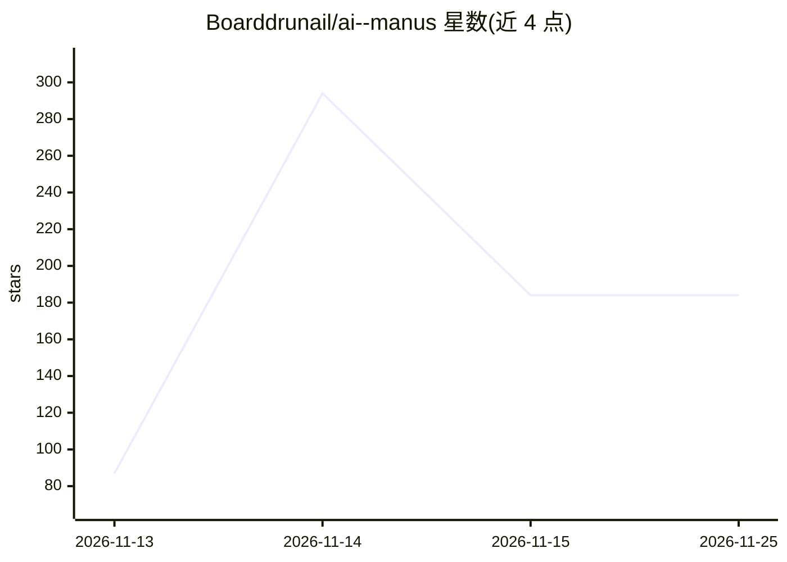

# Boarddrunail/ai--manus

⭐ 184 · Apache-2.0 · 推送 2026-11-15 · [GitHub](https://github.com/Boarddrunail/ai--manus) · 个人维护

**面向个人用户的自主 AI Agent，可运行代码与控制浏览器**

README 描述 Manus 为自主 AI Agent，代替用户执行多步任务：编写并运行脚本、打开网页与填写表单、组织研究资料与日常事务自动化。定位为家庭、学习与轻量办公场景的个人助手，而非企业平台。文档为产品介绍性质：给出硬件兼容表（最低 4 GB 内存、双核 CPU）、六步上手流程与使用建议，但未提供源码结构、安装命令、模型接入方式或 API 说明；页面顶部为下载链接与促销码 PROMO2026。

## 筛选速览

| 维度 | 判定 | 备注 |
|---|---|---|
| AI 角色 | `ai-native` | 本体是模型或模型工具 |
| 许可风险 | `permissive` | Apache-2.0 |
| 部署形态 | `None` |  |
| 模型依赖 | — | README 未给出锁定关系 |
| 硬件要求 | — | 无带数字的原话,不猜 |
| 安装摩擦 | `low` | 无编译、无系统依赖或容器化 |
| 成熟度 | — | 结构信号不足 |

## 能力要点

- 自主执行代码与浏览器操作的多步任务
- 脚本执行与浏览器操作可在同一流程内衔接
- 面向无需编程背景的个人用户，支持后台常驻辅助

## 适用场景

- 让 agent 代为查网页、填表和收集资料
- 自动整理研究笔记与运行小脚本
- 处理日常重复性小任务以减少手工操作

## 场景标签

`AI 助手` `浏览器自动化` · 领域:效率与自动化

## 证据(README 行号)

> L10: - **Autonomous Code Execution:** Manus AI agent runs code on its own to complete tasks, so you can focus on decisio
> L18: Manus is an autonomous AI agent designed to run code and control a browser on your behalf. Instead of acting like a
> L22: Manus is not a heavy studio suite or a complex enterprise platform. It is a focused helper built for home, study, a

## 星数曲线

2026-11-13 87 → 2026-11-25 184（+97）

---
*卡片 v1 · prompt 1.4 · 生成 2026-11-17 · 置信度 mid · 依据 README sha `67c3d4d92b69` · [字段定义](../../DATASET.md)*
