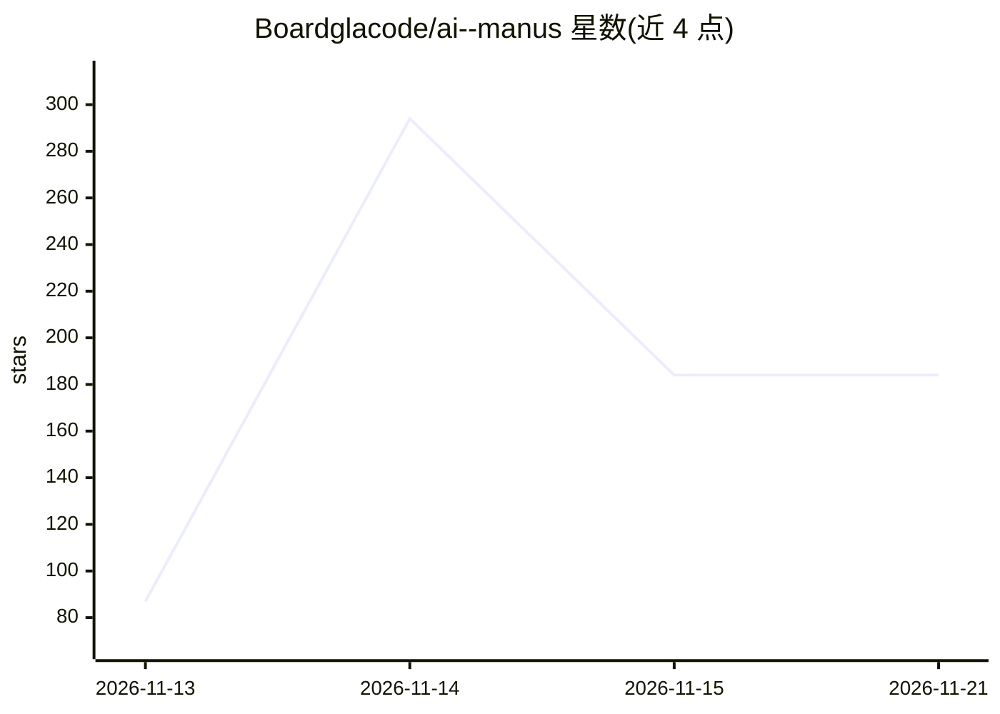

# Boardglacode/ai--manus

⭐ 184 · Apache-2.0 · 推送 2026-11-15 · [GitHub](https://github.com/Boardglacode/ai--manus) · 个人维护

**面向个人用户的自主 AI Agent：代写代码并控制浏览器完成任务**

README 描述的通用自主 AI 代理：接收自然语言指令后代为编写并执行脚本、控制浏览器（导航页面、填写表单、抓取信息），完成多步骤任务，可跨会话复用已学流程，面向家庭、学习与轻量办公场景的非开发者用户。以营销式文案为主，列出 CPU/内存等兼容性表格与'下载 Manus / PROMO2026'字样，但未给出任何具体的安装命令、源码结构或模型接入方式。

## 筛选速览

| 维度 | 判定 | 备注 |
|---|---|---|
| AI 角色 | `ai-native` | 本体是模型或模型工具 |
| 许可风险 | `permissive` | Apache-2.0 |
| 部署形态 | `None` |  |
| 模型依赖 | — | README 未给出锁定关系 |
| 硬件要求 | — | 无带数字的原话,不猜 |
| 安装摩擦 | `low` | 无编译、无系统依赖或容器化 |
| 成熟度 | — | 结构信号不足 |

## 能力要点

- 自主执行代码与浏览器操作的多步骤任务
- 代码与浏览器动作可在同一流程内衔接
- 面向无编程背景用户的日常/学习/轻办公任务委托

## 适用场景

- 让代理代为完成网页查资料、填表单等重复操作
- 学生用它整理研究笔记、跑小脚本
- 轻量办公中汇总多页面信息做摘要

## 场景标签

`AI 助手` `浏览器自动化` `编码 Agent` · 领域:效率与自动化

## 证据(README 行号)

> L10: - **Autonomous Code Execution:** Manus AI agent runs code on its own to complete tasks, so you can focus on decisio
> L18: Manus is an autonomous AI agent designed to run code and control a browser on your behalf. Instead of acting like a

## 星数曲线

2026-11-13 87 → 2026-11-21 184（+97）

---
*卡片 v1 · prompt 1.4 · 生成 2026-11-17 · 置信度 low · 依据 README sha `a3d88e202bf0` · [字段定义](../../DATASET.md)*
