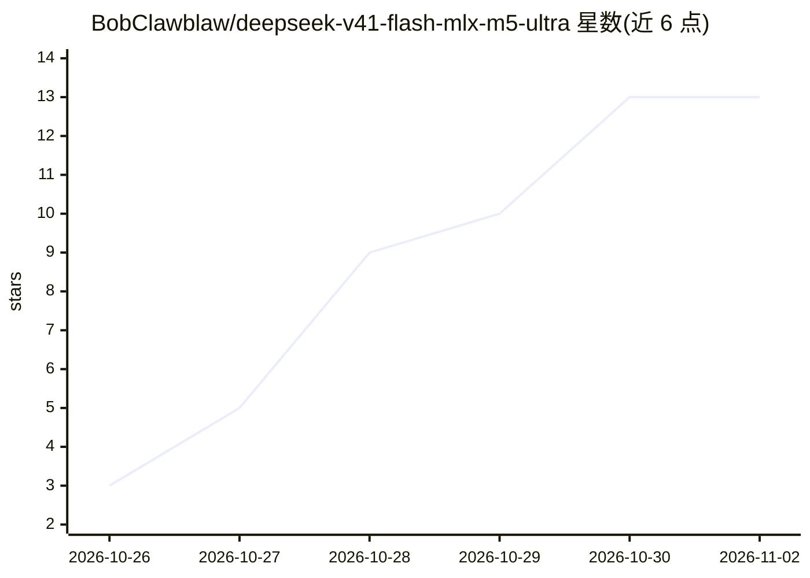

# BobClawblaw/deepseek-v41-flash-mlx-m5-ultra

⭐ 13 · Python · MIT · 推送 2026-10-23 · [GitHub](https://github.com/BobClawblaw/deepseek-v41-flash-mlx-m5-ultra) · [官网](https://huggingface.co/BobClawblaw/DeepSeek-V4.1-Flash-1017-TensorFold-e2e3-p4-h8) · 个人维护

**在单台 256GB M5 Ultra 上用 Metal 推理引擎服务 DeepSeek-V4.1-Flash**

记录在单台 Mac Studio（M5 Ultra，80 核 GPU、256GB 内存）上以 TensorFold 的 Metal 分支（deepseek-v41-main）服务 DeepSeek-V4.1-Flash-1017 的实现与基准：完整 1,048,576 token 上下文窗口，支持 DSpark 投机解码、prompt cache、图像、工具调用与 JSON 结构化输出。给出各构建 commit 的内核优化（simdgroup 矩阵分块、int8×int8 专家预填充、索引器加速）及逐次 logits 一致性校验。解码 70.7-104.9 tok/s，冷预填充 1,739-1,867 tok/s（8k-131k），1M prompt 首 token 740 s。面向具备该硬件的开发者/研究者，引擎非上游 TensorFold 一部分，需 418GB 检查点（权重约 200GB 内存映射，189GB engram 表驻留 SSD）。

## 筛选速览

| 维度 | 判定 | 备注 |
|---|---|---|
| AI 角色 | `ai-ecosystem` | LLM/agent 周边工具 |
| 许可风险 | `permissive` | MIT |
| 部署形态 | `None` |  |
| 模型依赖 | locked-api |  |
| 硬件要求 | — | 无带数字的原话,不猜 |
| 安装摩擦 | `medium` | 含编译或系统依赖之一 |
| 成熟度 | — | 结构信号不足 |

## 能力要点

- 完整 1M token 上下文窗口在单台 256GB M5 Ultra 上服务
- DSpark 投机解码、prompt cache、图像/WebP 输入、工具调用、JSON 结构化输出
- prompt 专家以 int8×int8 在 tensor units 运行，各构建均有 logits 一致性校验
- 逐 commit 记录内核优化与可复现基准（recipe-harness 的 stats/）

## 适用场景

- 在单台 Mac Studio 上本地运行 DeepSeek-V4.1-Flash 做长上下文任务
- 评估 Apple Silicon tensor units 上 MoE 模型的量化推理性能
- 复现 1M 上下文预填充与投机解码基准数据

## 场景标签

`推理引擎` · 领域:训练与推理

## 证据(README 行号)

> L3: DeepSeek-V4.1-Flash-1017 served on a single 256 GB Mac Studio (M5 Ultra) by TensorFold's native Metal engine.
> L5: - **Context:** the full 1,048,576-token window.

## 星数曲线

2026-10-26 3 → 2026-11-02 13（+10）

---
*卡片 v1 · prompt 1.4 · 生成 2026-10-31 · 置信度 high · 依据 README sha `9e9f98a22ce5` · [字段定义](../../DATASET.md)*
