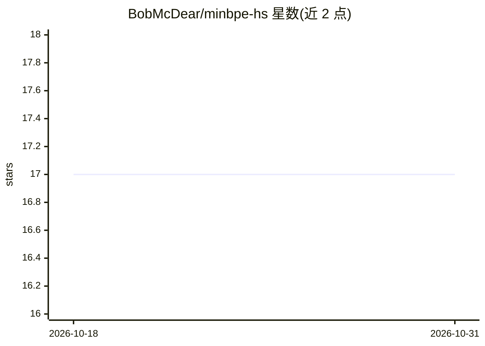

# BobMcDear/minbpe-hs

⭐ 17 · Haskell · MIT · 推送 2026-09-17 · [GitHub](https://github.com/BobMcDear/minbpe-hs) · 个人维护

**minbpe 的 Haskell 移植：字节级 BPE 分词器的训练与编解码**

将 Karpathy 的 minbpe 字节级 BPE 实现移植到 Haskell，提供 BPE.Basic（连续序列）与 BPE.Regex（正则分段、支持特殊 token）两种分词器，均支持训练、编码、解码，BPE.Base 提供核心操作与存储/加载工具。无 GPT4Tokenizer 对应实现（tiktoken 无 Haskell 前端）。通过 cabal 安装。已知限制：所用 regex-pcre 包对非 ASCII 字符按 UTF-8 字节逐个匹配，BPE.Regex 在非纯 ASCII 输入下输出与 Python 版不兼容。

## 筛选速览

| 维度 | 判定 | 备注 |
|---|---|---|
| AI 角色 | `ai-ecosystem` | LLM/agent 周边工具 |
| 许可风险 | `permissive` | MIT |
| 部署形态 | `None` |  |
| 模型依赖 | — | README 未给出锁定关系 |
| 硬件要求 | — | 无带数字的原话,不猜 |
| 安装摩擦 | `low` | 无编译、无系统依赖或容器化 |
| 成熟度 | — | 结构信号不足 |

## 能力要点

- 提供 Basic 与 Regex 两种分词器，含训练/编码/解码
- BPE.Base 支持模型存储与加载
- 结果与 Python 版 minbpe 基本一致（非 ASCII 输入除外）

## 适用场景

- 用函数式语言学习 BPE 算法的另一表述
- 在 Haskell 项目中训练和使用字节级 BPE 分词器
- 对比研究 BPE 在函数式与命令式实现中的差异

## 场景标签

 · 领域:NLP/分词器

## 证据(README 行号)

> L11: minbpe-hs is a port of Andrej Karpathy's concise byte-level byte pair encoding (BPE) implementation, minbpe, to Has
> L13: Similar to minbpe, ```BPE.Basic``` and ```BPE.Regex``` both supply the same fundamental functionalities of training

## 星数曲线



2026-10-18 17 → 2026-10-31 17（+0）


---
*卡片 v1 · prompt 1.4 · 生成 2026-10-30 · 置信度 high · 依据 README sha `c4007d67e980` · [字段定义](../../DATASET.md)*
