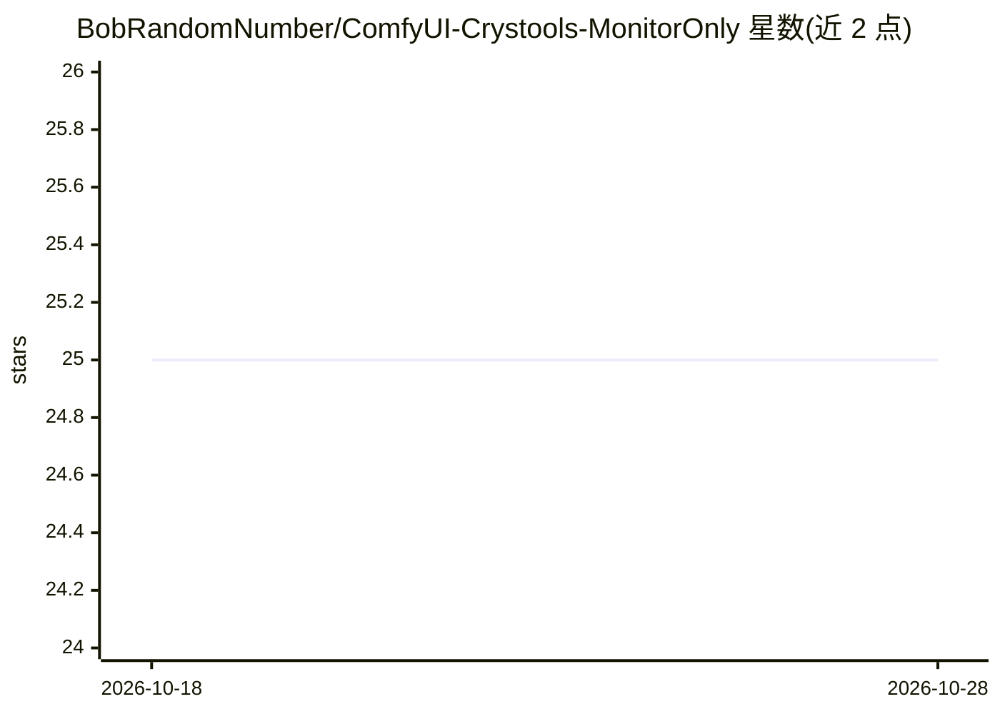

# BobRandomNumber/ComfyUI-Crystools-MonitorOnly

⭐ 25 · TypeScript · MIT · 推送 2026-05-04 · [GitHub](https://github.com/BobRandomNumber/ComfyUI-Crystools-MonitorOnly) · 个人维护

**ComfyUI 内 Nvidia 资源监控扩展：实时显示 CPU/GPU/显存等**

ComfyUI-Crystools 的轻量 fork，仅保留实时系统资源监控功能（CPU、RAM、GPU、VRAM、HDD），在 ComfyUI 界面内显示监视条，面向 Nvidia GPU 用户。移除了原版的全部功能节点与多数依赖，将 pynvml 替换为 nvidia-ml-py。安装方式为克隆仓库到 custom_nodes 目录并 pip 安装依赖，可在设置中开关各监视项、调整刷新率与监视条尺寸。

## 筛选速览

| 维度 | 判定 | 备注 |
|---|---|---|
| AI 角色 | `ai-ecosystem` | LLM/agent 周边工具 |
| 许可风险 | `permissive` | MIT |
| 部署形态 | `library` | 以包/库形式分发 |
| 模型依赖 | — | README 未给出锁定关系 |
| 硬件要求 | — | 无带数字的原话,不猜 |
| 安装摩擦 | `low` | 无编译、无系统依赖或容器化 |
| 成熟度 | — | 结构信号不足 |

## 能力要点

- ComfyUI 界面内实时监控 CPU/RAM/GPU/VRAM/HDD
- 移除全部功能节点与多数依赖，仅保留监控功能
- 依赖从 pynvml 迁移到 nvidia-ml-py

## 适用场景

- 在 ComfyUI 中跑图时查看显存与 GPU 占用
- 需要 Crystools 监控功能但不想安装完整节点套件

## 场景标签

 · 领域:AI 工作流工具/系统监控

## 证据(README 行号)

> L7: This is a, "Monitor Only" version of the Crystools extension for ComfyUI. It provides the real-time system resource 
> L9: The purpose of this fork is to provide the monitoring functionality for Nvidia only without the additional node suit

## 星数曲线

2026-10-18 25 → 2026-10-28 25（+0）

---
*卡片 v1 · prompt 1.4 · 生成 2026-10-27 · 置信度 high · 依据 README sha `3eadeedeb47f` · [字段定义](../../DATASET.md)*
