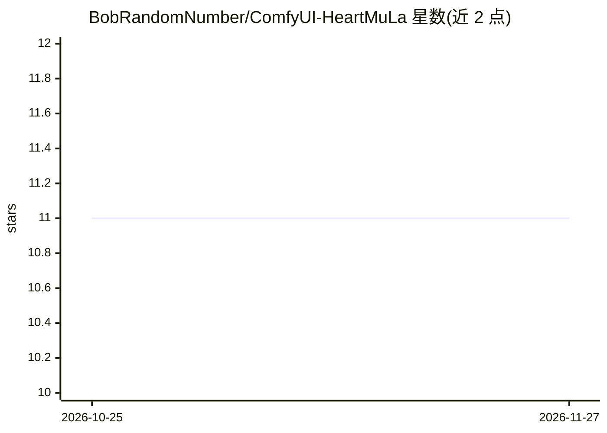

# BobRandomNumber/ComfyUI-HeartMuLa

⭐ 11 · Python · Apache-2.0 · 推送 2026-11-22 · [GitHub](https://github.com/BobRandomNumber/ComfyUI-HeartMuLa) · 个人维护

**ComfyUI 扩展节点：生成歌曲并转录歌词**

基于 HeartMuLa 模型家族的 ComfyUI 扩展，提供文本到音乐生成（从歌词与风格标签生成音频）与歌词转录（Whisper 架构语音转文本，支持长音频）两类节点。节点按 V3 架构组织，LLM 与 Codec 分离加载以便内存管理，支持 torch.compile 分块编译加速与音频后处理（归一化、滤波、增益）。安装需克隆仓库至 ComfyUI custom_nodes 目录并手动下载模型权重与配置文件到指定目录结构。

## 筛选速览

| 维度 | 判定 | 备注 |
|---|---|---|
| AI 角色 | `ai-native` | 本体是模型或模型工具 |
| 许可风险 | `permissive` | Apache-2.0 |
| 部署形态 | `library` | 以包/库形式分发 |
| 模型依赖 | — | README 未给出锁定关系 |
| 硬件要求 | — | 无带数字的原话,不猜 |
| 安装摩擦 | `low` | 无编译、无系统依赖或容器化 |
| 成熟度 | — | 结构信号不足 |

## 能力要点

- 文本到音乐生成：由歌词与风格标签生成音频
- 基于 Whisper 架构的歌词转录，支持长音频
- LLM 与 Codec 分离加载，支持 torch.compile 加速
- 内置音频后处理器（归一化/滤波/增益）

## 适用场景

- 在 ComfyUI 工作流中生成歌曲音频
- 从音频中自动转录歌词文本
- 按风格标签（如钢琴、婚礼）定制音乐生成

## 场景标签

`语音识别` · 领域:感知与多模态

## 证据(README 行号)

> L5: A ComfyUI extension for music generation and lyrics transcription based on the HeartMuLa model family and heartlib s
> L12: - **Text-to-Music**: Generate high-fidelity audio from lyrics and style tags.

## 星数曲线

2026-10-25 11 → 2026-11-27 11（+0）

---
*卡片 v1 · prompt 1.4 · 生成 2026-11-19 · 置信度 high · 依据 README sha `7c4c0a1d9646` · [字段定义](../../DATASET.md)*
