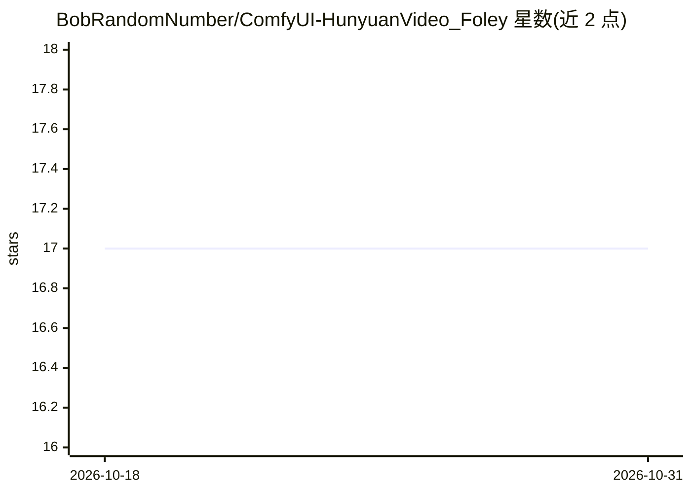

# BobRandomNumber/ComfyUI-HunyuanVideo_Foley

⭐ 17 · Python · NOASSERTION · 推送 2026-02-18 · [GitHub](https://github.com/BobRandomNumber/ComfyUI-HunyuanVideo_Foley) · 个人维护

**ComfyUI 节点集：用 HunyuanVideo-Foley 为视频生成拟音音频**

基于腾讯 HunyuanVideo-Foley 模型的 ComfyUI 自定义节点集，从视频帧与文本提示生成 48kHz 立体声拟音音频。工作流分为模型加载、采样、VAE 解码三类节点，结构对应 Stable Diffusion 工作流；借助 Synchformer 做音画同步，CLAP 支持正/负文本控制，SigLIP2 作视觉编码，DAC VAE 解码音频。模型需手动下载到指定目录后可完全离线运行；提供 Low VRAM 模式与更小的 XL 模型，推荐约 10-12GB 显存。

## 筛选速览

| 维度 | 判定 | 备注 |
|---|---|---|
| AI 角色 | `ai-native` | 本体是模型或模型工具 |
| 许可风险 | `none` | NOASSERTION |
| 部署形态 | `library` | 以包/库形式分发 |
| 模型依赖 | — | README 未给出锁定关系 |
| 硬件要求 | — | 无带数字的原话,不猜 |
| 安装摩擦 | `low` | 无编译、无系统依赖或容器化 |
| 成熟度 | — | 结构信号不足 |

## 能力要点

- 视频帧+文本提示生成 48kHz 立体声拟音音频
- Synchformer 音画同步与 CLAP 正/负文本控制
- 模型手动下载后完全离线运行
- Low VRAM 模式（生成后卸载模型至内存）与轻量 XL 模型可选

## 适用场景

- 在 ComfyUI 中为视频生成同步的音效/拟音
- 用文本提示控制生成音效的类型
- 显存受限或只需单次生成时使用低显存模式

## 场景标签

 · 领域:生成式音频/视频工具

## 证据(README 行号)

> L3: Generate high-fidelity, synchronized foley audio for any video directly within ComfyUI, powered by Tencent's Hunyuan
> L101: This is the core node where the audio generation happens. It takes video frames, prompts, and sampling parameters 

## 星数曲线

2026-10-18 17 → 2026-10-31 17（+0）

---
*卡片 v1 · prompt 1.4 · 生成 2026-10-30 · 置信度 mid · 依据 README sha `a6c1551c44c2` · [字段定义](../../DATASET.md)*
