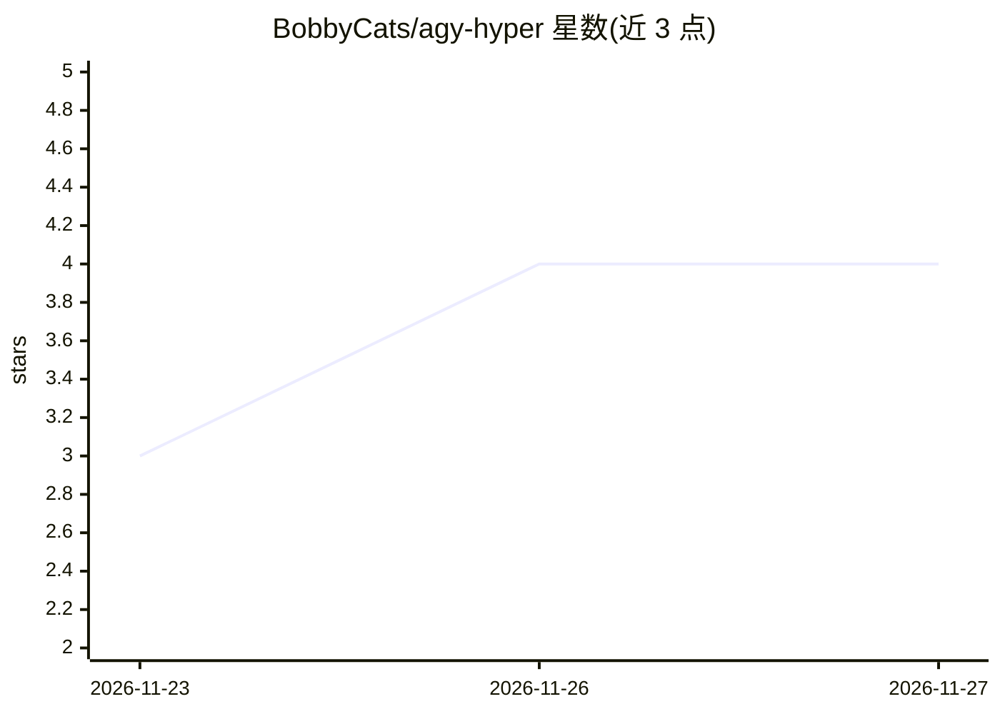

# BobbyCats/agy-hyper

⭐ 4 · Rust · MIT · 推送 2026-11-25 · [GitHub](https://github.com/BobbyCats/agy-hyper) · 个人维护 · 中文 README

**为 Google Antigravity 用户诊断配额消耗并加速 MCP 调用的本地插件**

面向 Google Antigravity（App 与 CLI）的 Rust 插件：本地离线审计会话转录中的配额消耗（生成 PNG/SVG 报告）、显示各模型 prompt 缓存 TTL 倒计量的实时驾驶舱、提供基于 BLAKE3 WAL 的行级差异与一键撤销，以及分层（Observe/Safe/Balanced/Hyper）的 Rust MCP 工具加速。通过原生 MCP、Lifecycle Hooks 与 Rules 接入，支持 macOS/Linux/Windows 一行安装或源码编译，界面支持英/中/日三语。

## 筛选速览

| 维度 | 判定 | 备注 |
|---|---|---|
| AI 角色 | `ai-ecosystem` | LLM/agent 周边工具 |
| 许可风险 | `permissive` | MIT |
| 部署形态 | `None` |  |
| 模型依赖 | — | README 未给出锁定关系 |
| 硬件要求 | — | 无带数字的原话,不猜 |
| 安装摩擦 | `low` | 无编译、无系统依赖或容器化 |
| 成熟度 | — | 结构信号不足 |

## 能力要点

- 10 秒本地配额消耗审计，输出 PNG/SVG 卡片，100% 离线零上传
- 实时缓存 TTL 倒计量的侧边栏驾驶舱与 Context X-Ray 组成分析
- BLAKE3 WAL 行级差异与一键撤销，保留原生 inline diff
- 分层 Rust MCP 加速与零信任沙箱（workspace jail、Secret Shield）

## 适用场景

- 排查 Antigravity 配额为何消耗过快
- 在终端状态栏查看上下文与缓存命中状态
- 需要保留原生 diff 的同时加速 MCP 文件读取/编辑

## 场景标签

`编码 Agent` · 领域:编码与开发

## 证据(README 行号)

> L5: **Local Quota Burn Audit, Live Cache-TTL Cockpit, Inline WAL Undo & Rust MCP Accelerator for Google Antigravity (App
> L26: > **100% Official Antigravity Plugin Protocol**: Built strictly on native MCP, Lifecycle Hooks, Rules, and `SIDECAR
> L18: Analyzing **80 real local sessions (4,184 turns)** exposed two hidden killers: half of coding sessions load **`151k

## 星数曲线

2026-11-23 3 → 2026-11-27 4（+1）

---
*卡片 v1 · prompt 1.4 · 生成 2026-11-23 · 置信度 high · 依据 README sha `342c47e64fde` · [字段定义](../../DATASET.md)*
