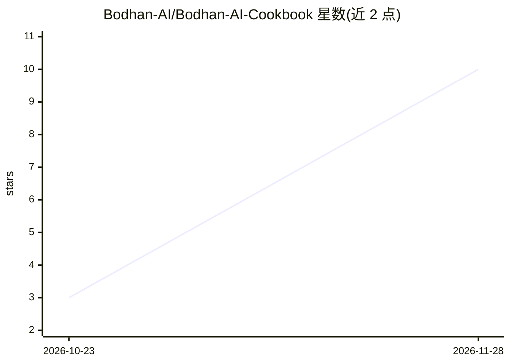

# Bodhan-AI/Bodhan-AI-Cookbook

⭐ 10 · Jupyter Notebook · Apache-2.0 · 推送 2026-11-24 · [GitHub](https://github.com/Bodhan-AI/Bodhan-AI-Cookbook) · 组织维护

**面向开发者的 Bodhan AI API 示例与教程集**

收录使用 Bodhan AI API 的示例代码、指南与端到端项目，覆盖语音识别、语音合成、翻译、音译与文档 OCR 五类能力，重点支持印度各语言。使用前需在 console.bodhan.ai 注册获取 API key，通过环境变量或 .env 文件配置；示例多为 Python 3.10+ notebook，API 本身为 HTTPS 接口，且 /v1 路由兼容 OpenAI 风格请求。仓库按入门教程、示例项目、第三方集成、示例数据与 CI 校验脚本组织，并设有待认领的贡献选题。

## 筛选速览

| 维度 | 判定 | 备注 |
|---|---|---|
| AI 角色 | `ai-knowledge` | 知识聚合/清单类 |
| 许可风险 | `permissive` | Apache-2.0 |
| 部署形态 | `None` |  |
| 模型依赖 | — | README 未给出锁定关系 |
| 硬件要求 | — | 无带数字的原话,不猜 |
| 安装摩擦 | `low` | 无编译、无系统依赖或容器化 |
| 成熟度 | — | 结构信号不足 |

## 能力要点

- 5 个模型端点：indic-transcribe/translate/transliterate/speak/ocr，覆盖 22-25 种印度语言
- /v1 路由兼容 OpenAI 风格请求，更换 base_url 即可使用 OpenAI SDK
- 提供语音转录+多语言翻译+朗读的完整示例项目 Voice Notice Translator
- 提供模型 allowlist JSON 与 CI 校验脚本用于贡献规范

## 适用场景

- 为印度语言应用接入语音识别、翻译或 TTS API
- 按 notebook 学习各端点的调用方式与错误处理
- 基于 TEMPLATE 为该 API 贡献新示例项目

## 场景标签

`教程课程` · 领域:学习与行业

## 证据(README 行号)

> L7: Example code, guides, and end-to-end projects for building with the Bodhan AI API: speech to text, text to speech, t
> L54: |`getting-started/`|Focused, single-API tutorial notebooks: speech to text, text to speech, translation, transliter
> L86: LiveKit, Pipecat, Twilio/Exotel, n8n, Vercel AI SDK and LangChain guides are open for contribution; see `integratio

## 星数曲线

2026-10-23 3 → 2026-11-28 10（+7）

---
*卡片 v1 · prompt 1.4 · 生成 2026-11-28 · 置信度 high · 依据 README sha `a749c7e808b0` · [字段定义](../../DATASET.md)*
