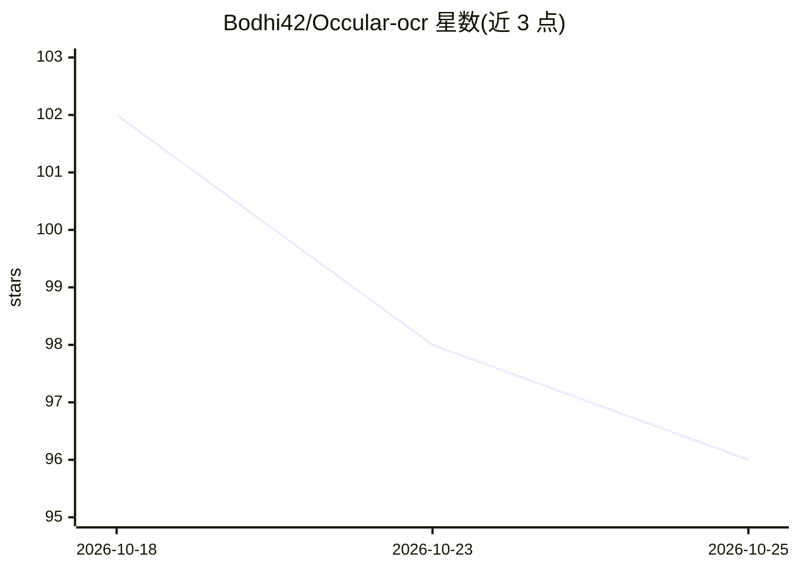

# Bodhi42/Occular-ocr

⭐ 96 · Python · Apache-2.0 · 推送 2026-10-11 · [GitHub](https://github.com/Bodhi42/Occular-ocr) · 个人维护

**面向俄语文档的 OCR 库：pip 安装、CPU 开箱即用**

面向俄语文档的 Python OCR 库：DBNet 检测 + SVTR 识别器 + 4-gram 俄语语言模型引导的 CTC beam search 解码，输出页面文本或带坐标与置信度的行级结果。支持 14 种西里尔文字语言、PDF 处理、表格结构重建、方向检测与神经去弯曲，全部模型以 ONNX 格式在 CPU 上运行（可选 CUDA）。纯 Python 解码栈使安装无需编译；可选 Rust 模块加速解码。限制：基准数据集不公开；Intel Mac + Python 3.14 无 ONNX Runtime 构建。

## 筛选速览

| 维度 | 判定 | 备注 |
|---|---|---|
| AI 角色 | `ai-native` | 本体是模型或模型工具 |
| 许可风险 | `permissive` | Apache-2.0 |
| 部署形态 | `library` | 以包/库形式分发 |
| 模型依赖 | — | README 未给出锁定关系 |
| 硬件要求 | `cpu-ok` | |
| 安装摩擦 | `medium` | 含编译或系统依赖之一 |
| 成熟度 | — | 结构信号不足 |

## 能力要点

- DBNet + SVTR + 4-gram LM beam search 的 OCR 流水线
- 全 ONNX 模型，CPU 开箱即用，gpu=True 可切 CUDA（无 PyTorch）
- pip 单命令安装，纯 Python 解码栈零原生依赖；可选 Rust 加速模块
- 支持 14 种西里尔文字语言、多列阅读顺序、表格结构（含合并单元格）与方向校正

## 适用场景

- 批量识别俄语表单、证件、银行流水、发票等文档
- 把扫描文件夹/PDF 转成 txt 文本
- 处理手机拍照的歪斜或弯曲页面后做 OCR

## 场景标签

`OCR` · 领域:感知与多模态

## 证据(README 行号)

> L12: Occular-OCR is a document OCR library purpose-built for **Russian**. It pairs a DBNet text detector with an
> L262: image ─▶ deskew ─▶ DBNet detector ─▶ crops ─▶ SVTR recognizer ─▶ beam + n-gram LM ─▶ text

## 星数曲线

2026-10-18 102 → 2026-10-25 96（-6）

---
*卡片 v1 · prompt 1.4 · 生成 2026-10-23 · 置信度 high · 依据 README sha `1694be12111a` · [字段定义](../../DATASET.md)*
