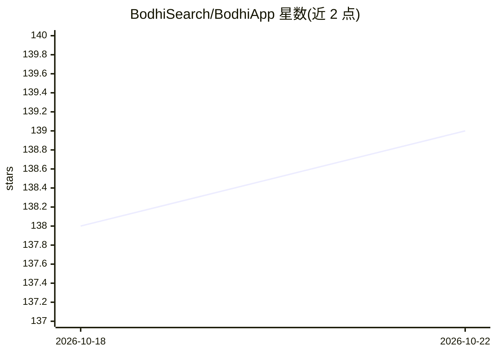

# BodhiSearch/BodhiApp

⭐ 139 · TypeScript · 推送 2026-09-20 · [GitHub](https://github.com/BodhiSearch/BodhiApp) · [官网](https://getbodhi.app/) · 组织维护

**本地运行开源 LLM 的应用：OpenAI 兼容 API 与内置聊天界面**

基于 llama.cpp、面向本地运行开源 LLM 的桌面/服务应用，通过 HuggingFace 生态下载 GGUF 模型文件并同时服务两类用户：技术用户获得 OpenAI 兼容的 chat completions 与 models API 端点，附带 OpenAPI 文档与内置 SwaggerUI；非技术用户使用内置 Chat UI，可发现、下载与本地硬件兼容的模型。提供 API token 管理、动态设置调整。目前原生发布仅限 Mac（Homebrew cask 或 GitHub Release），另有 CPU/CUDA/ROCm/Vulkan 四种 Docker 镜像变体，并发布 TypeScript API 客户端 npm 包。

## 筛选速览

| 维度 | 判定 | 备注 |
|---|---|---|
| AI 角色 | `ai-ecosystem` | LLM/agent 周边工具 |
| 许可风险 | `none` | — |
| 部署形态 | `desktop` | 安装包/桌面程序 |
| 模型依赖 | local-ok | 支持本地模型 |
| 硬件要求 | `cpu-ok` | |
| 安装摩擦 | `low` | 无编译、无系统依赖或容器化 |
| 成熟度 | — | 结构信号不足 |

## 能力要点

- OpenAI 兼容的 chat completions 与 models API 端点，含 SwaggerUI
- 从 HuggingFace 下载并管理 GGUF 模型，按本地硬件筛选兼容模型
- 内置面向非技术用户的 Chat UI（流式输出、Markdown）
- Docker 提供 CPU/CUDA/ROCm/Vulkan 四种硬件加速变体

## 适用场景

- 在本地机器上运行开源 LLM 并通过 OpenAI 兼容 API 接入其他应用
- 不熟悉命令行的用户通过图形界面使用本地模型
- 开发者用 SwaggerUI 探索和测试本地 LLM API

## 场景标签

`聊天机器人` `推理引擎` · 领域:对话与助手

## 证据(README 行号)

> L11: Bodhi App allows you to run Open Source LLMs locally. It utilizes the Huggingface ecosystem for accessing open-sour
> L15: For technical users, it provides OpenAI-compatible chat completions and models API endpoints. It includes comprehen

## 星数曲线

2026-10-18 138 → 2026-10-22 139（+1）

---
*卡片 v1 · prompt 1.4 · 生成 2026-10-22 · 置信度 mid · 依据 README sha `d4ccddfca916` · [字段定义](../../DATASET.md)*
