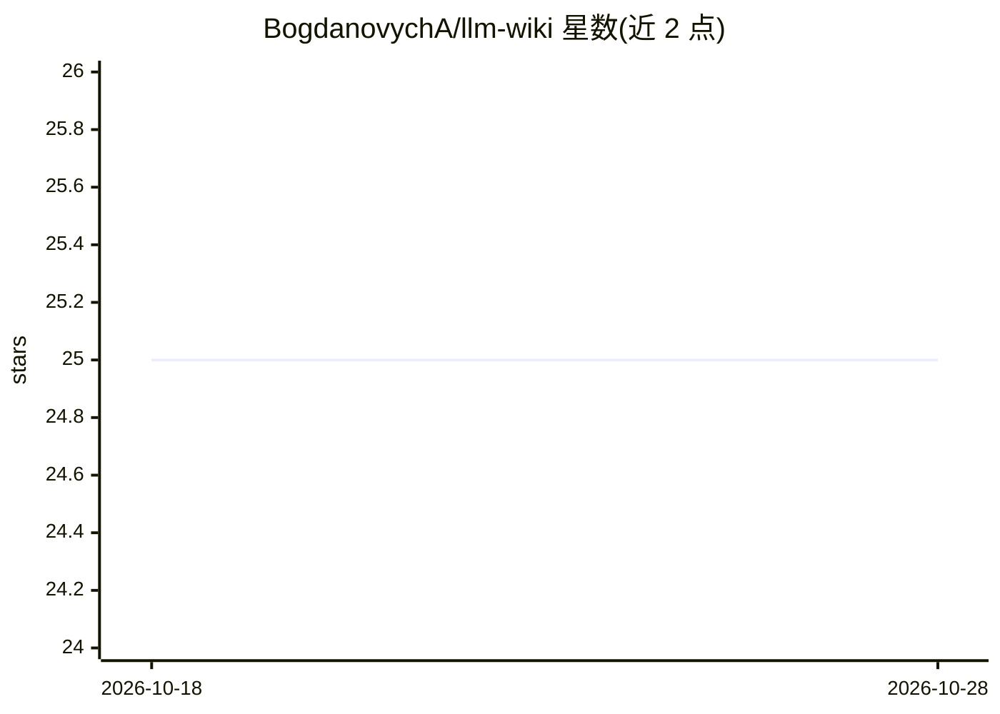

# BogdanovychA/llm-wiki

⭐ 25 · Python · MIT · 推送 2026-08-05 · [GitHub](https://github.com/BogdanovychA/llm-wiki) · [官网](https://apps.bogdanovych.org/en/app/llm-wiki) · 个人维护 · 中文 README

**供 LLM agent 填充与维护的个人/团队知识库模板**

基于 Karpathy 的 LLM Wiki 模式、适配乌克兰语的持久化知识库模板仓库：通过 LLM agent（如 OpenCode、Antigravity、Claude Code）执行导入（ingest）、查询（query）、完整性检查（lint）三类工作流，自动结构化新资料、交叉链接概念页、归档原始来源并更新索引。仓库提供 AGENTS.md 行为规则、页面模板、inbox/raw/wiki 目录结构；使用前需按所选 agent 将 AGENTS.md 复制或软链为对应文件名（如 CLAUDE.md）。本体不含模型实现，agent 与运行时由用户自备。

## 筛选速览

| 维度 | 判定 | 备注 |
|---|---|---|
| AI 角色 | `ai-ecosystem` | LLM/agent 周边工具 |
| 许可风险 | `permissive` | MIT |
| 部署形态 | `None` |  |
| 模型依赖 | — | README 未给出锁定关系 |
| 硬件要求 | — | 无带数字的原话,不猜 |
| 安装摩擦 | `low` | 无编译、无系统依赖或容器化 |
| 成熟度 | — | 结构信号不足 |

## 能力要点

- ingest/query/lint 三类 agent 技能工作流
- inbox→不可变 raw 归档→wiki 概念页→索引的结构化目录约定
- agent 可执行规则文件 AGENTS.md 与页面模板
- 支持用 Obsidian 等编辑器浏览与可视化页面关系图

## 适用场景

- 搭建由 LLM agent 维护的个人或团队知识库
- 将新收到的文本资料自动结构化为可交叉链接的 wiki 页面
- 定期让 agent 检查知识库的失效链接与逻辑矛盾

## 场景标签

`知识库管理` · 领域:知识与检索

## 证据(README 行号)

> L7: Персистентна (постійна) кумулятивна вікі-система, яка використовує агентів на базі LLM для імпорту, структурування, 
> L44: Для взаємодії з вікі використовуйте LLM-агентів (наприклад: OpenCode, Antigravity, Claude Code тощо).

## 星数曲线

2026-10-18 25 → 2026-10-28 25（+0）

---
*卡片 v1 · prompt 1.4 · 生成 2026-10-27 · 置信度 high · 依据 README sha `d1bb9d31bbb6` · [字段定义](../../DATASET.md)*
