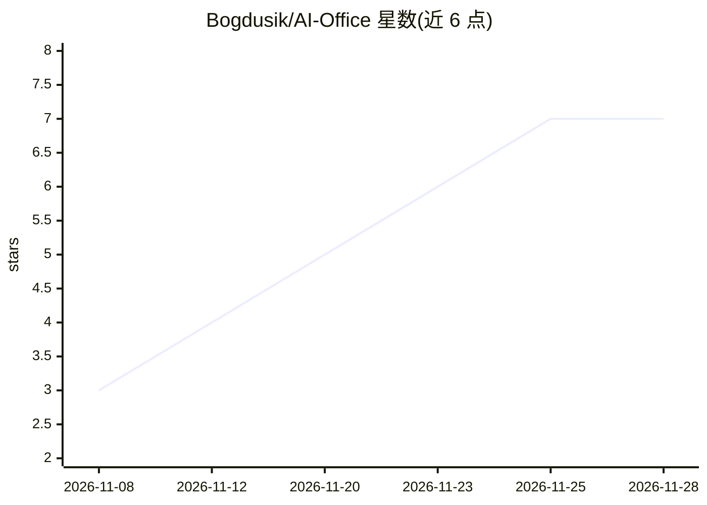

# Bogdusik/AI-Office

⭐ 7 · Python · NOASSERTION · 推送 2026-11-19 · [GitHub](https://github.com/Bogdusik/AI-Office) · 个人维护 · 中文 README

**本地 3D 办公室：AI 员工在 Ollama 上分阶段执行任务**

单用户本地应用：用户是 3D 办公楼的'主任'，员一个是 AI agent。任务按 plan → web research → draft → self-check 分阶段在 Ollama 本地模型上运行，结果以带来源的版本化 Markdown 进入审核队列，可接受或退回。前端 Next.js 15 + React Three Fiber，后端 FastAPI + PostgreSQL，所有动画状态来自数据库而非脚本。附带基于 SearXNG 的网络检索工具、Adzuna/Reed 求职代理，及 GPU 队列、断点恢复、防 DNS 重绑定的安全护栏等工程机制。

## 筛选速览

| 维度 | 判定 | 备注 |
|---|---|---|
| AI 角色 | `ai-native` | 本体是模型或模型工具 |
| 许可风险 | `permissive` | NOASSERTION |
| 部署形态 | `self-host` | docker 或自建部署 |
| 模型依赖 | local-ok | 支持本地模型 |
| 硬件要求 | — | 无带数字的原话,不猜 |
| 安装摩擦 | `low` | 无编译、无系统依赖或容器化 |
| 成熟度 | — | 结构信号不足 |

## 能力要点

- 任务四阶段流水线（计划→检索→起草→自检）+ 人工审核队列
- 本地运行：Ollama 模型 + SearXNG 检索，一切状态存于 PostgreSQL
- 代码级求职资格硬过滤与带编号来源的研究输出
- GPU 信号量队列、任务断点续跑、防 DNS rebinding 的抓取护栏

## 适用场景

- 在本地用多 agent 并行跑带来源的写作与研究任务
- 用 agent 检索并筛选 Adzuna/Reed 招聘信息
- 把本地 LLM 工作流（队列/重试/工具）可视化为 3D 场景

## 场景标签

`多智能体` `科研工具` · 领域:Agent 开发

## 证据(README 行号)

> L5: **A 3D office where local AI agents do real work: tasks run in stages on Ollama, with web research, a job-search too
> L18: A local, single-user app where you are the director of a 3D office and the staff are AI agents. You give an agent a
> L19: task; the agent drives in, parks, takes the lift or the stairs to their desk and works through it in stages (plan →

## 星数曲线

2026-11-08 3 → 2026-11-28 7（+4）

---
*卡片 v1 · prompt 1.4 · 生成 2026-11-21 · 置信度 high · 依据 README sha `61ade9ee53ef` · [字段定义](../../DATASET.md)*
