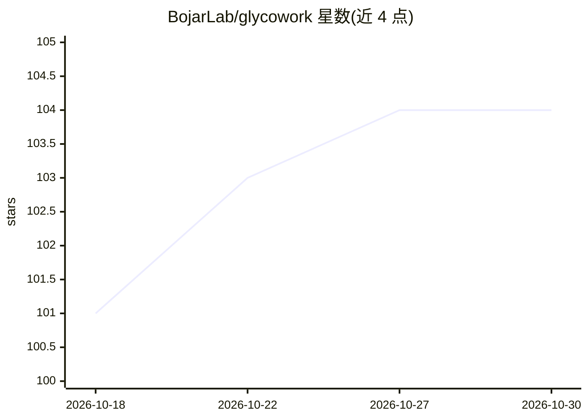

# BojarLab/glycowork

⭐ 104 · Jupyter Notebook · MIT · 推送 2026-10-29 · [GitHub](https://github.com/BojarLab/glycowork) · [官网](https://Bojarlab.github.io/glycowork) · 组织维护

**糖链（glycan）数据科学 Python 库：解析、分析与机器学习**

面向糖组学/糖生物学研究者的 Python 包：原生读取 IUPAC-condensed 并将 14 种以上糖链序列格式（GlycoCT、WURCS、Oxford、SMILES 等）及主流糖组学软件导出统一规范化；以有向图表示糖链，提供带通配符的子图同构 motif 检索与糖链正则表达式引擎。内置 50,461 条带物种/组织/疾病标注的糖链序列、>790,000 条蛋白-糖链结合数据、82 个分析就绪数据集，以及 LectinOracle、SweetNet、GIFFLAR 等 5 个预训练深度学习模型（预测结合特异性、物种、糖基化位点）。另提供差异表达、ANOVA、生物合成网络重建、SNFG 出版级绘图等统计与可视化功能，并通过 pip 安装，附无代码 GUI 与网页界面。

## 筛选速览

| 维度 | 判定 | 备注 |
|---|---|---|
| AI 角色 | `ai-native` | 本体是模型或模型工具 |
| 许可风险 | `permissive` | MIT |
| 部署形态 | `desktop` | 安装包/桌面程序 |
| 模型依赖 | — | README 未给出锁定关系 |
| 硬件要求 | — | 无带数字的原话,不猜 |
| 安装摩擦 | `low` | 无编译、无系统依赖或容器化 |
| 成熟度 | — | 结构信号不足 |

## 能力要点

- 14 种以上糖链序列格式读入并规范化，5 种格式可导出
- 图原生 motif 检索（子图同构+通配符）与糖链正则表达式引擎
- 内置 50,461 条糖链、>790,000 条结合数据、82 个数据集
- 附带 LectinOracle/SweetNet/GIFFLAR 等 5 个预训练深度学习模型

## 适用场景

- 对糖组学/糖蛋白组学数据做差异表达、ANOVA 与 motif 富集分析
- 预测蛋白的糖链结合特异性或由糖链预测物种来源
- 将各种格式的糖链序列统一规范化并绘制 SNFG 出版级图
- 重建并比较不同条件下的糖链生物合成网络

## 场景标签

 · 领域:生物信息学/糖生物学

## 证据(README 行号)

> L11: `glycowork` is the Python package for glycan data science. Glycans are
> L126: Additionally, we store these trained deep learning models for easy
> L137:  - a graph convolutional neural network trained to predict species from

## 星数曲线

2026-10-18 101 → 2026-10-30 104（+3）

---
*卡片 v1 · prompt 1.4 · 生成 2026-10-23 · 置信度 high · 依据 README sha `5fb4ff3c424d` · [字段定义](../../DATASET.md)*
