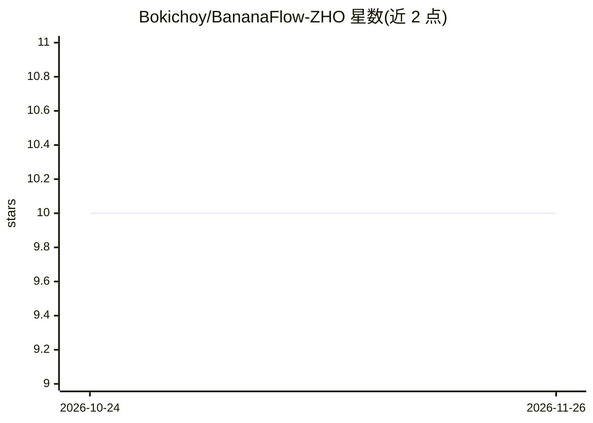

# Bokichoy/BananaFlow-ZHO

⭐ 10 · TypeScript · 推送 2026-10-14 · [GitHub](https://github.com/Bokichoy/BananaFlow-ZHO) · 个人维护

**面向普通用户的任务自动化桌面应用，基于 Nano Banana 与 Veo3 模型**

README 自述为跨平台桌面应用，运行于 Windows 10+、macOS 10.15+ 与 Linux，通过 Releases 页面下载安装包（.exe / 拖入 Applications / 终端 chmod+运行）安装。功能描述包括内置自动化模板、可自定义工作流与应用内文档。底层声明构建于 Nano Banana 与 Veo3 模型之上，但 README 未说明具体输入输出形态、如何调用模型或 API 细节，项目自述与主题标签（data-analytics 等）之间存在不一致。

## 筛选速览

| 维度 | 判定 | 备注 |
|---|---|---|
| AI 角色 | `ai-native` | 本体是模型或模型工具 |
| 许可风险 | `none` | — |
| 部署形态 | `desktop` | 安装包/桌面程序 |
| 模型依赖 | — | README 未给出锁定关系 |
| 硬件要求 | — | 无带数字的原话,不猜 |
| 安装摩擦 | `low` | 无编译、无系统依赖或容器化 |
| 成熟度 | — | 结构信号不足 |

## 能力要点

- 基于 Nano Banana 与 Veo3 模型构建
- 提供预置自动化模板与可自定义工作流
- 提供 Windows/macOS/Linux 三平台安装包

## 适用场景

- 下载安装包后在本机运行任务自动化流程
- 使用预置模板快速搭建个人工作流

## 场景标签

`工作流自动化` · 领域:效率与自动化

## 证据(README 行号)

> L4: Welcome to BananaFlow-ZHO! This application helps you automate your workflows simply and effectively. Built on the N
> L13: 1. Visit the Releases Page to download the latest version.

## 星数曲线

2026-10-24 10 → 2026-11-26 10（+0）

---
*卡片 v1 · prompt 1.4 · 生成 2026-11-20 · 置信度 low · 依据 README sha `e7d9daea8938` · [字段定义](../../DATASET.md)*
