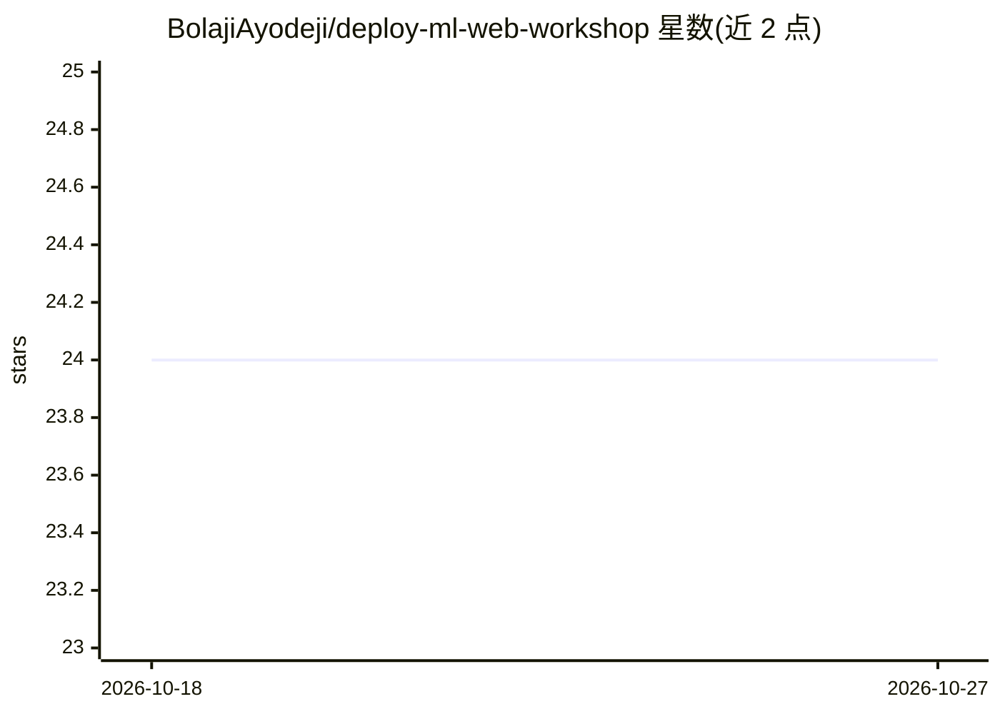

# BolajiAyodeji/deploy-ml-web-workshop

⭐ 24 · Jupyter Notebook · MIT · 推送 2026-10-08 · [GitHub](https://github.com/BolajiAyodeji/deploy-ml-web-workshop) · [官网](https://mbpti-flask-app.fly.dev) · 个人维护

**ML 模型部署到 Web 的实操教程仓库（约 3 小时工作坊）**

面向初学 ML 工程线上的教学仓库：讲解用 Python/Scikit-Learn 构建模型、序列化后用 Flask 封装为 API、用 Postman 测试、分别用 Flask 与 Nextjs 构建 Web 应用，并部署到 Fly 与 Vercel。共 8 节课程，其中基于预训练模型与 Vercel AI SDK 的课程标注为 TBA（未完成）。模型开发环节使用 Google Colab 托管 Notebook，避免本地安装；本仓库本身为教程内容（CC BY-SA 4.0）加代码示例（MIT）。

## 筛选速览

| 维度 | 判定 | 备注 |
|---|---|---|
| AI 角色 | `ai-knowledge` | 知识聚合/清单类 |
| 许可风险 | `permissive` | MIT |
| 部署形态 | `library` | 以包/库形式分发 |
| 模型依赖 | — | README 未给出锁定关系 |
| 硬件要求 | — | 无带数字的原话,不猜 |
| 安装摩擦 | `low` | 无编译、无系统依赖或容器化 |
| 成熟度 | — | 结构信号不足 |

## 能力要点

- 覆盖建模→API→Web→云部署的 8 节课程
- 提供 Flask API 与 Nextjs 前端两条构建路线，部署到 Fly 与 Vercel
- 模型开发使用 Google Colab 托管 Notebook，附本地安装备选路径

## 适用场景

- 跟着课程学习把 Scikit-Learn 模型变成可访问的 API
- 练习用 Flask 与 Nextjs 为模型搭建 Web 前端
- 了解 Fly/Vercel 上的云部署流程

## 场景标签

`教程课程` · 领域:学习与行业

## 证据(README 行号)

> L5: In this workshop, Bolaji will introduce you to machine learning model deployment by showing you the steps and proces
> L175: ## 📚 Workshop Lessons

## 星数曲线

2026-10-18 24 → 2026-10-27 24（+0）

---
*卡片 v1 · prompt 1.4 · 生成 2026-10-27 · 置信度 mid · 依据 README sha `e41d256c906a` · [字段定义](../../DATASET.md)*
