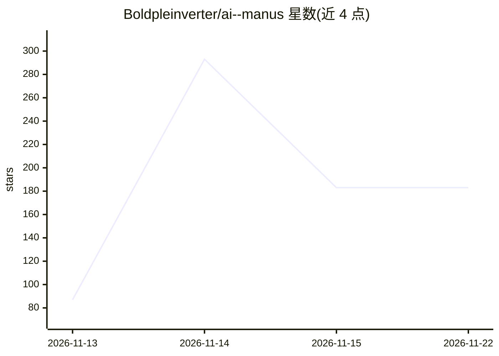

# Boldpleinverter/ai--manus

⭐ 183 · Apache-2.0 · 推送 2026-11-15 · [GitHub](https://github.com/Boldpleinverter/ai--manus) · 个人维护

**自主 AI Agent：代用户执行代码与控制浏览器完成任务**

Manus 定位为自主 AI 代理，面向家庭、学习与轻量办公场景的用户，以自然语言指令驱动多步任务：可编写并执行脚本、打开网页、填写表单、跨页面收集信息，并支持代码与浏览器操作在同一工作流中衔接。README 描述其可在后台作为个人助手运行，跨会话保持任务模式。内容以营销式功能介绍为主，未给出具体技术架构、模型接入方式或安装命令细节，仅提供下载入口与硬件兼容性表。

## 筛选速览

| 维度 | 判定 | 备注 |
|---|---|---|
| AI 角色 | `ai-native` | 本体是模型或模型工具 |
| 许可风险 | `permissive` | Apache-2.0 |
| 部署形态 | `None` |  |
| 模型依赖 | — | README 未给出锁定关系 |
| 硬件要求 | — | 无带数字的原话,不猜 |
| 安装摩擦 | `low` | 无编译、无系统依赖或容器化 |
| 成熟度 | — | 结构信号不足 |

## 能力要点

- 自主执行代码与脚本
- 浏览器控制：导航网页、填表、抓取信息
- 代码与浏览器操作可在同一任务流中衔接
- 面向家庭、学习与轻量办公的小规模任务

## 适用场景

- 让代理代为收集网页资料并整理
- 自动填写重复性表单
- 运行小脚本与快速实验
- 整理研究笔记与日常杂务自动化

## 场景标签

`浏览器自动化` `编码 Agent` · 领域:效率与自动化

## 证据(README 行号)

> L10: - **Autonomous Code Execution:** Manus AI agent runs code on its own to complete tasks, so you can focus on decisio
> L18: Manus is an autonomous AI agent designed to run code and control a browser on your behalf. Instead of acting like a

## 星数曲线

2026-11-13 87 → 2026-11-22 183（+96）

---
*卡片 v1 · prompt 1.4 · 生成 2026-11-17 · 置信度 low · 依据 README sha `0f78ee3a5dd2` · [字段定义](../../DATASET.md)*
