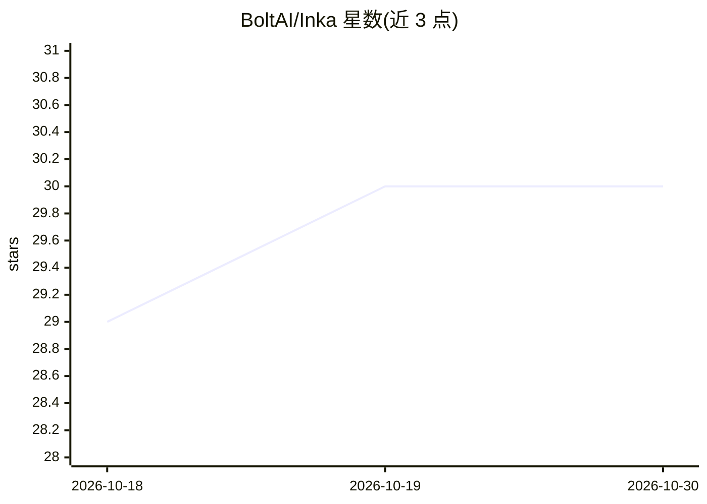

# BoltAI/Inka

⭐ 30 · Kotlin · MIT · 推送 2026-08-14 · [GitHub](https://github.com/BoltAI/Inka) · [官网](https://inka.page) · 个人维护

**BOOX 墨水屏平板的原生 Android AI 手写对话日记本**

面向 BOOX Note Air 墨水平板的原生 Android 应用：用户用触控笔在空白页书写，停笔后页面以手写体文字逐词显示 AI 回复；支持本地笔记本历史、内置书写人设、BYO-key 自带 API key 的服务商配置（扫码或粘贴）。手写识别模型下载后在设备本地运行，AI 回复需网络与 API key。另有可选的实验性神经网络手写合成，需用户自行配置服务器（提供 Docker 脚本）。无账号、无分析/遥测/后端。通过 Google Play、GitHub Releases APK 侧载或源码构建安装。

## 筛选速览

| 维度 | 判定 | 备注 |
|---|---|---|
| AI 角色 | `ai-native` | 本体是模型或模型工具 |
| 许可风险 | `permissive` | MIT |
| 部署形态 | `None` |  |
| 模型依赖 | — | README 未给出锁定关系 |
| 硬件要求 | — | 无带数字的原话,不猜 |
| 安装摩擦 | `low` | 无编译、无系统依赖或容器化 |
| 成熟度 | — | 结构信号不足 |

## 能力要点

- 笔写输入、停笔后页面以手写体逐词呈现 AI 回复
- BYO-key 服务商配置，支持手机扫码辅助设置 API key
- 手写识别模型下载后在设备本地运行
- 无账号、无分析、无遥测、无后端

## 适用场景

- 在 BOOX 墨水屏平板上用笔与 AI 进行手写式对话
- 以手写日记形式记录并保存本地笔记本历史
- 切换不同书写人设获得不同风格的回复

## 场景标签

`聊天机器人` · 领域:对话与助手

## 证据(README 行号)

> L3: Hi, I'm Daniel, and I build AI apps. Inspired by Maxime Rivest's Riddle, I built Inka as an experiment exploring dif
> L5: Inka is a native Android app built specifically for BOOX Note Air tablets, tested on the BOOX Note Air 5C.
> L7: Write with the pen, rest your hand, and the page answers back in a flowing handwritten voice.
> L19: - Pen-first writing on BOOX tablets
> L20: - Handwritten replies that appear directly on the page

## 星数曲线

2026-10-18 29 → 2026-10-30 30（+1）

---
*卡片 v1 · prompt 1.4 · 生成 2026-10-26 · 置信度 high · 依据 README sha `e064e1fedc83` · [字段定义](../../DATASET.md)*
