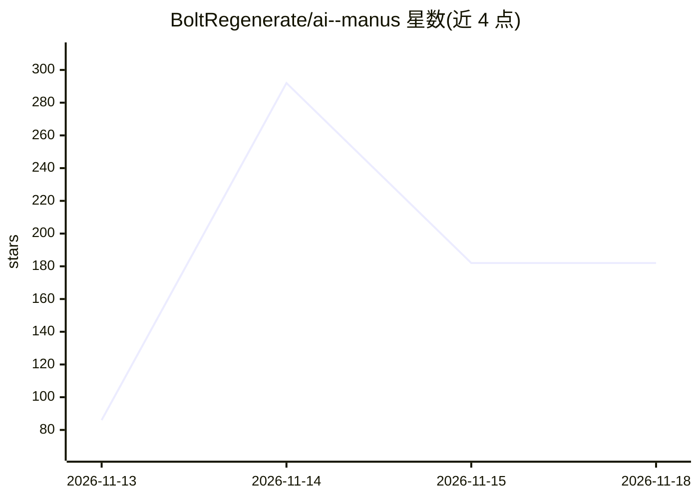

# BoltRegenerate/ai--manus

⭐ 182 · Apache-2.0 · 推送 2026-11-15 · [GitHub](https://github.com/BoltRegenerate/ai--manus) · 个人维护

**自主执行代码与浏览器操作的通用 AI Agent 系统**

面向普通用户和小型任务的自主 AI Agent：用户用自然语言描述需求，Agent 自行编写并执行脚本、打开网页、填写表单、完成多步骤任务，无需编程基础。定位为家庭、学习与轻量办公场景的后台个人助手，非企业平台。README 提供硬件兼容表（最低 4 GB 内存、双核 CPU）与使用步骤说明，但未给出安装命令、源码结构或接入的模型提供方等可验证细节。

## 筛选速览

| 维度 | 判定 | 备注 |
|---|---|---|
| AI 角色 | `ai-native` | 本体是模型或模型工具 |
| 许可风险 | `permissive` | Apache-2.0 |
| 部署形态 | `None` |  |
| 模型依赖 | — | README 未给出锁定关系 |
| 硬件要求 | — | 无带数字的原话,不猜 |
| 安装摩擦 | `low` | 无编译、无系统依赖或容器化 |
| 成熟度 | — | 结构信号不足 |

## 能力要点

- 自主执行代码以完成任务
- 浏览器控制：导航网页、填写表单、采集信息
- 代码与浏览器动作可在同一多步骤任务流中衔接
- 面向无编程背景用户的后台个人助手定位

## 适用场景

- 让学生整理研究笔记、跑小脚本
- 远程工作者从多个网页收集数据
- 日常重复性小事的自动代办与提醒

## 场景标签

`AI 助手` `浏览器自动化` · 领域:效率与自动化

## 证据(README 行号)

> L10: - **Autonomous Code Execution:** Manus AI agent runs code on its own to complete tasks, so you can focus on decisio
> L18: Manus is an autonomous AI agent designed to run code and control a browser on your behalf. Instead of acting like a

## 星数曲线

2026-11-13 86 → 2026-11-18 182（+96）

---
*卡片 v1 · prompt 1.4 · 生成 2026-11-17 · 置信度 low · 依据 README sha `0f78ee3a5dd2` · [字段定义](../../DATASET.md)*
