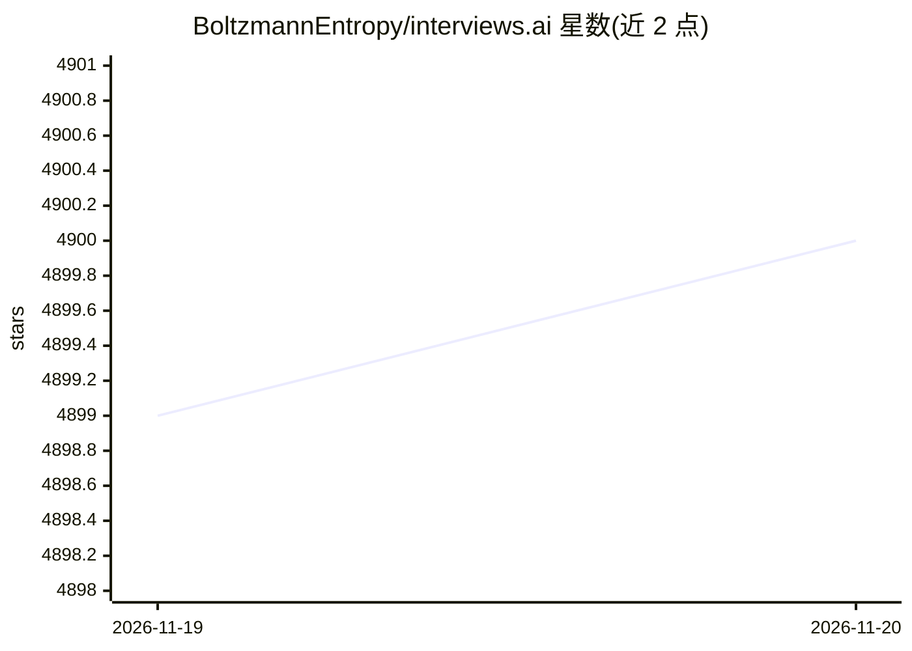

# BoltzmannEntropy/interviews.ai

⭐ 4,900 · 推送 2026-11-19 · [GitHub](https://github.com/BoltzmannEntropy/interviews.ai) · [官网](https://interviews.ai) · 个人维护

**面向研究生与求职者的深度学习面试题解书（数百道完整解答）**

《Deep Learning Interviews》一书，收录数百道带完整逐步解答的 AI/深度学习面试题，覆盖信息论、贝叶斯深度学习、逻辑回归、集成学习、特征提取与深度学习等核心主题，部分章节配有 PyTorch、Python 与 C++ 代码示例。目标读者为有量化背景的研究生与数据科学求职者，也可用于机器学习硕博考试复习。第二版提供免费 PDF（arXiv），纸质版经 Amazon 销售，禁止出售或商用其内容；另有含扩散模型与 LLM 新章节的第三版在编写中，尚未发售。

## 筛选速览

| 维度 | 判定 | 备注 |
|---|---|---|
| AI 角色 | `ai-knowledge` | 知识聚合/清单类 |
| 许可风险 | `none` | — |
| 部署形态 | `None` |  |
| 模型依赖 | — | README 未给出锁定关系 |
| 硬件要求 | — | 无带数字的原话,不猜 |
| 安装摩擦 | `low` | 无编译、无系统依赖或容器化 |
| 成熟度 | — | 结构信号不足 |

## 能力要点

- 数百道带逐步推导的完整解答面试题（约 400 页）
- 覆盖信息论、贝叶斯统计、微积分与自动微分等数学基础
- 部分章节含 PyTorch、Python 与 C++ 代码示例
- 第二版免费 PDF 可供个人学习使用

## 适用场景

- 准备深度学习/数据科学岗位的技术面试
- 机器学习硕博课程的考试复习
- 系统梳理深度学习数学基础的参考资料

## 场景标签

`教程课程` · 领域:学习与行业

## 证据(README 行号)

> L1: Deep Learning Interviews book: Hundreds of fully solved job interview questions from a wide range of key topics in A
> L95: This book (www.interviews.ai) was written for you: an aspiring data scientist with a quantitative background, facin
> L100: The second edition of Deep Learning Interviews (The Amazon Softcover is printed in B&W) is home to hundreds of ful

## 星数曲线

2026-11-19 4,899 → 2026-11-20 4,900（+1）

---
*卡片 v1 · prompt 1.4 · 生成 2026-11-19 · 置信度 high · 依据 README sha `a42d532af35f` · [字段定义](../../DATASET.md)*
