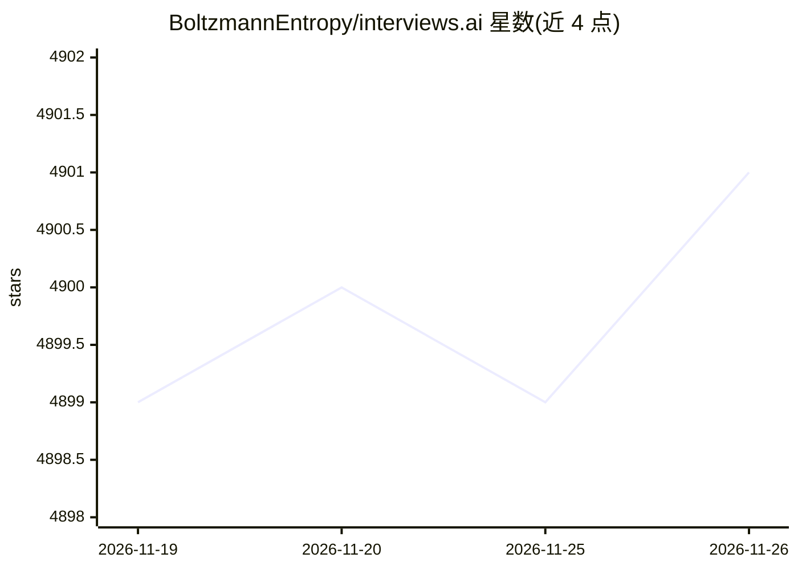

# BoltzmannEntropy/interviews.ai

⭐ 4,901 · 推送 2026-11-21 · [GitHub](https://github.com/BoltzmannEntropy/interviews.ai) · [官网](https://interviews.ai) · 个人维护

**为深度学习求职者与研究生提供带完整解答的面试题集**

《Deep Learning Interviews》是一本面向深度学习岗位面试与研究生水平考试的问题集：第二版可在 arXiv 免费获取 PDF 并有纸质版销售，第三版（582 题、21 章、124 图）尚在编写中，新增扩散模型、大语言模型及训练与部署工程内容。每道题附编号公式推导的完整解答，题目按难度（easy/standard/hard）与角色（core/reinforcement/transfer/advanced）标注。第二版覆盖信息论、贝叶斯深度学习、集成学习、特征提取等主题，含 PyTorch/Python/C++ 代码示例，并发布多轮勘误。

## 筛选速览

| 维度 | 判定 | 备注 |
|---|---|---|
| AI 角色 | `ai-knowledge` | 知识聚合/清单类 |
| 许可风险 | `none` | — |
| 部署形态 | `None` |  |
| 模型依赖 | — | README 未给出锁定关系 |
| 硬件要求 | — | 无带数字的原话,不猜 |
| 安装摩擦 | `low` | 无编译、无系统依赖或容器化 |
| 成熟度 | — | 结构信号不足 |

## 能力要点

- 582 道已解答题（第三版），每题附完整推导与解答
- 题目按难度与角色（core/reinforcement/transfer/advanced）标注
- 第二版 PDF 免费发布于 arXiv，纸质版经 Amazon 销售
- 覆盖扩散模型、KV cache、大语言模型等第三版新增主题

## 适用场景

- 准备深度学习岗位的技术面试
- 研究生课程的复习与考试准备
- 按核心题优先的策略在面试临近时集中训练

## 场景标签

`教程课程` · 领域:学习与行业

## 证据(README 行号)

> L14: *Deep Learning Interviews* is a problem book for people who prepare for deep learning job interviews and graduate-l
> L38: |**Problems**|582, every one with a full solution derived in numbered equations|
> L49: |**Level**|easy, standard, hard|An easy problem asks for one idea in a short calculation. A hard problem combines s

## 星数曲线

2026-11-19 4,899 → 2026-11-26 4,901（+2）

---
*卡片 v1 · prompt 1.4 · 生成 2026-11-22 · 置信度 high · 依据 README sha `1ac6436a3df6` · [字段定义](../../DATASET.md)*
