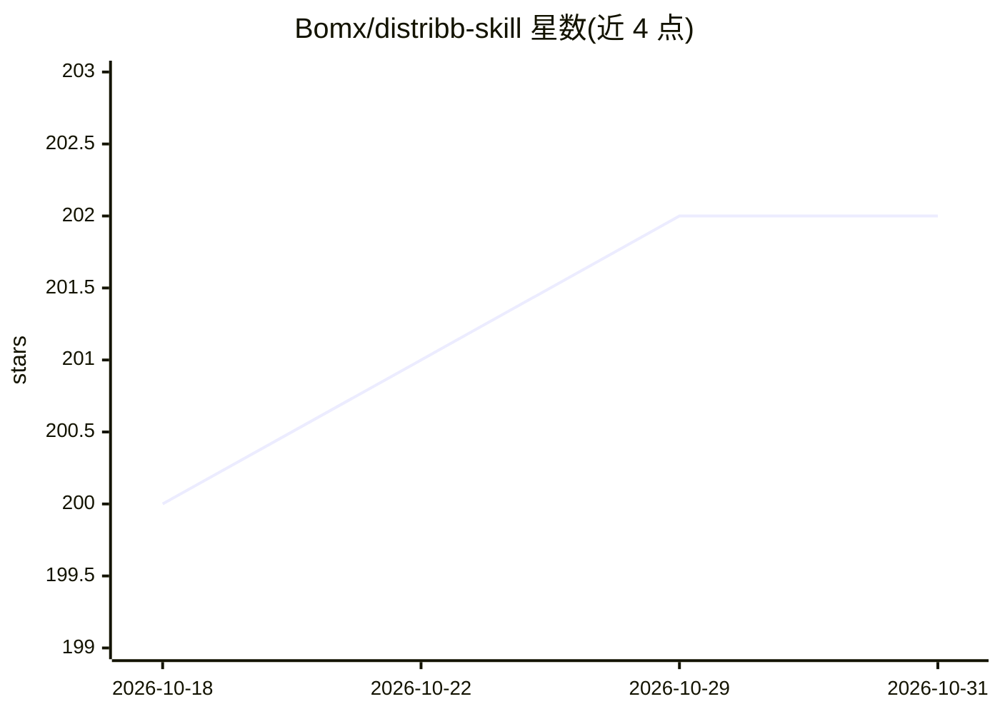

# Bomx/distribb-skill

⭐ 202 · Python · 推送 2026-10-11 · [GitHub](https://github.com/Bomx/distribb-skill) · [官网](https://distribb.io) · 组织维护

**面向 AI agent 的 SEO 自动化技能包，接入 Distribb 数据与发布网络**

Distribb 提供的 agent 技能包，可安装到 Claude Code、Codex、OpenClaw 等 agent 环境，通过斜杠命令与 API 让 agent 执行 SEO 流程：Google Search Console 审计、关键词研究、文章写作与发布、外链交换、内容日历、社媒发布与评论触发 DM、Google Business Profile 管理、付费广告与 Microworkers 众包任务管理。API 调用仅依赖 curl 与 jq，另带可选 Python 辅助脚本和远程 MCP 服务器。需注册 distribb.io 获取 API key，付费计划起步 $49/月，免费计划已停售。

## 筛选速览

| 维度 | 判定 | 备注 |
|---|---|---|
| AI 角色 | `ai-ecosystem` | LLM/agent 周边工具 |
| 许可风险 | `none` | — |
| 部署形态 | `library` | 以包/库形式分发 |
| 模型依赖 | — | README 未给出锁定关系 |
| 硬件要求 | — | 无带数字的原话,不猜 |
| 安装摩擦 | `low` | 无编译、无系统依赖或容器化 |
| 成熟度 | — | 结构信号不足 |

## 能力要点

- 20+ 个斜杠命令覆盖审计、写作、外链、社媒、广告等 SEO 工作流
- 9 项分析的 GSC 全站审计（CTR、内容衰减、关键词蚕食、竞品差距等）
- 真实企业间外链交换网络，提交时自动检测并计入积分
- API 层仅依赖 curl + jq，无需安装；另提供 MCP 服务器与可选 Python CLI

## 适用场景

- 让 Claude/Codex 等 agent 按流程执行关键词研究与文章发布
- 通过 agent 管理 Instagram/YouTube 发布与评论触发 DM
- 对网站做 GSC 数据驱动的 SEO 审计与页面优化

## 场景标签

 · 领域:SEO/数字营销

## 证据(README 行号)

> L9: SEO automation for AI agents. Use any AI model you want. Distribb provides the infrastructure: real keyword data, ba
> L1: ## Install as a skill
> L136: ## MCP Server (Cursor / Claude Desktop)

## 星数曲线

2026-10-18 200 → 2026-10-31 202（+2）

---
*卡片 v1 · prompt 1.4 · 生成 2026-10-22 · 置信度 mid · 依据 README sha `453641ced93f` · [字段定义](../../DATASET.md)*
