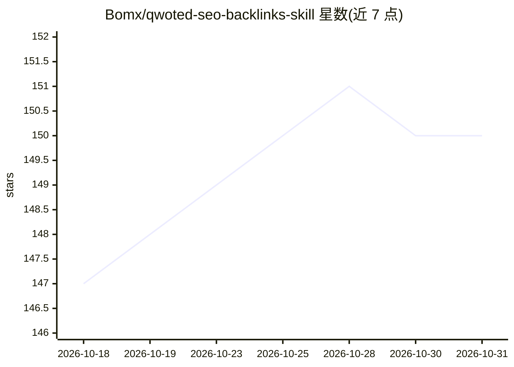

# Bomx/qwoted-seo-backlinks-skill

⭐ 150 · Python · 推送 2026-05-02 · [GitHub](https://github.com/Bomx/qwoted-seo-backlinks-skill) · [官网](https://distribb.io) · 组织维护

**让 Claude Code 代理在 Qwoted 上找 PR 机会并投放引用链接的技能**

面向 Claude Code（或可执行 shell 的任意 AI 代理）的技能包：通过 4 个 Python 脚本（requests + playwright）驱动 Qwoted 平台，覆盖登录与 cookie 保存、专家 Source 档案创建、经 Algolia 索引检索记者需求、起草并提交 pitch。特色是 Stage 3——让 Claude 按方法论研究并生成含 40-80 条引用统计、Chart.js 图表与 schema.org 标记的 HTML 统计页作为可被引用资产。pitch 默认 dry-run，需 --send 且逐条经用户批准；也可脱离 AI 作为普通 CLI 使用。MIT 许可，由 Distribb 团队维护。

## 筛选速览

| 维度 | 判定 | 备注 |
|---|---|---|
| AI 角色 | `ai-ecosystem` | LLM/agent 周边工具 |
| 许可风险 | `none` | — |
| 部署形态 | `library` | 以包/库形式分发 |
| 模型依赖 | — | README 未给出锁定关系 |
| 硬件要求 | — | 无带数字的原话,不猜 |
| 安装摩擦 | `low` | 无编译、无系统依赖或容器化 |
| 成熟度 | — | 结构信号不足 |

## 能力要点

- 4 个纯 Python 脚本驱动 Qwoted 登录/档案/检索/pitch，输出结构化 RESULT JSON
- Stage 3 生成含 40-80 条来源统计、Chart.js 图表与 schema.org 标记的 HTML 统计页
- pitch 默认 dry-run，提交需 --send 且逐条经用户批准，已投递记录防重复
- 无遥测，会话 cookie 仅存本地 ~/.qwoted/

## 适用场景

- 让我的 AI 代理每天在 Qwoted 上找记者需求并代为投放 pitch
- 自动生成可被记者引用的带来源统计页面做外链资产
- 作为普通 CLI 脚本手动检索和管理 Qwoted 投放

## 场景标签

`浏览器自动化` · 领域:效率与自动化

## 证据(README 行号)

> L30: This skill teaches Claude Code (or any AI agent that can shell out) how
> L104: |`SKILL.md`|The Claude Code playbook itself — frontmatter + 4-stage workflow.|

## 星数曲线

2026-10-18 147 → 2026-10-31 150（+3）

---
*卡片 v1 · prompt 1.4 · 生成 2026-10-22 · 置信度 mid · 依据 README sha `1b82f4658dd6` · [字段定义](../../DATASET.md)*
