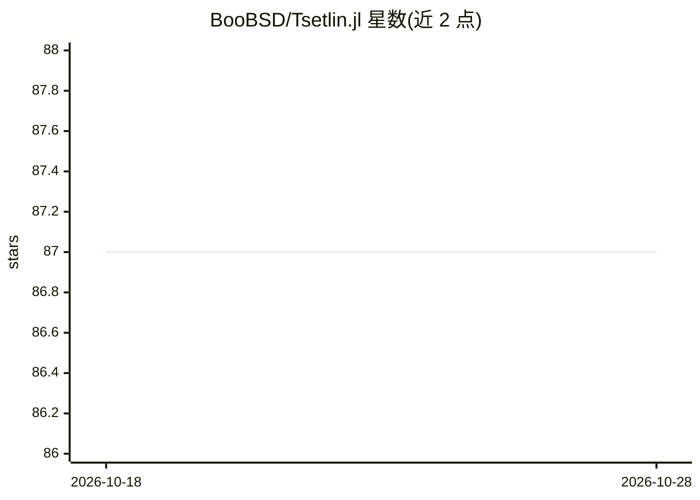

# BooBSD/Tsetlin.jl

⭐ 87 · Julia · MIT · 推送 2026-10-25 · [GitHub](https://github.com/BooBSD/Tsetlin.jl) · [官网](https://arxiv.org/pdf/2508.08350) · 个人维护

**Julia 实现的 Fuzzy-Pattern Tsetlin Machine 机器学习库**

用 Julia 编写的 Fuzzy-Pattern Tsetlin Machine 实现，零外部依赖，提供二分类与多分类、单/多线程训练与推理、BitSet 索引、模型编译与保存加载、内置基准测试与可解释性工具。README 称 MNIST 训练 1000 epochs 在 CPU 上 5 秒完成，并展示基于 Tsetlin Machine 的字符级文本生成示例（Shakespeare）。附 MNIST、CIFAR-10/100、IMDb 情感分析等示例与 arXiv 论文引用。

## 筛选速览

| 维度 | 判定 | 备注 |
|---|---|---|
| AI 角色 | `ai-native` | 本体是模型或模型工具 |
| 许可风险 | `permissive` | MIT |
| 部署形态 | `None` |  |
| 模型依赖 | — | README 未给出锁定关系 |
| 硬件要求 | — | 无带数字的原话,不猜 |
| 安装摩擦 | `low` | 无编译、无系统依赖或容器化 |
| 成熟度 | — | 结构信号不足 |

## 能力要点

- 二分类与多分类、单/多线程训练与推理
- 模型编译、保存/加载与内置基准测试和可解释性工具
- 含字符级文本生成示例与多个数据集示例

## 适用场景

- 在 CPU 上训练 Tsetlin Machine 做分类任务
- 用 Tsetlin Machine 做字符级文本生成实验
- 对模型输入做 literal 层面的可解释性分析

## 场景标签

 · 领域:机器学习

## 证据(README 行号)

> L7: This repository provides an alternative Fuzzy-Pattern Tsetlin Machine implementation with zero external dependencies
> L13:  - Binary classifier.
> L28: Below is an example of character-level **text generation** in the style of Shakespeare.

## 星数曲线

2026-10-18 87 → 2026-10-28 87（+0）

---
*卡片 v1 · prompt 1.4 · 生成 2026-10-23 · 置信度 high · 依据 README sha `2cdff817fbe7` · [字段定义](../../DATASET.md)*
