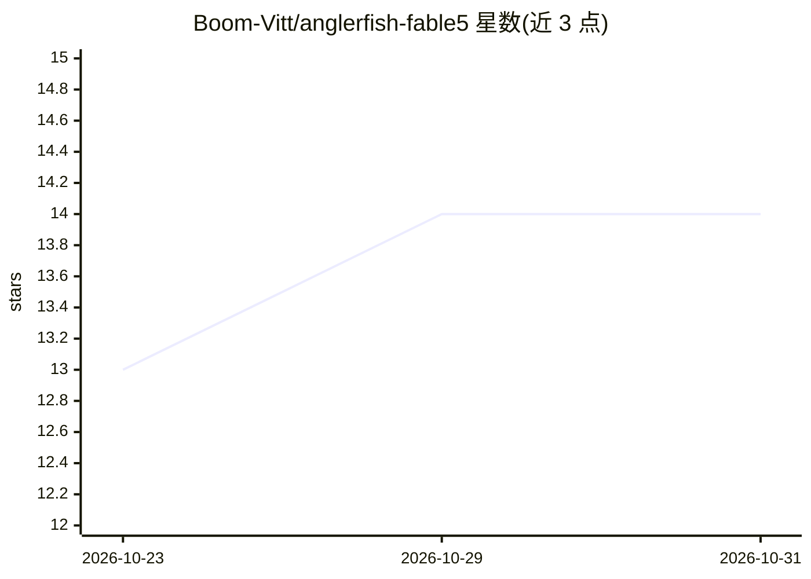

# Boom-Vitt/anglerfish-fable5

⭐ 14 · HTML · 推送 2026-10-22 · [GitHub](https://github.com/Boom-Vitt/anglerfish-fable5) · 个人维护

**Binance 风格量化仪表盘 + LLM 驱动的 Binance 自动交易机器人**

两部分组成：单文件 HTML 仪表盘（浅色 Binance 风格），含实时 TradingView 图表（BTCUSDT）、3D 概率地形、Galton 板、关系图谱与 Autotrade 控制台，双击 index.html 即可打开；另有 Python 交易机器人 autotrade.py，经 ccxt 读取 Binance 行情，由 OpenRouter 的 LLM（默认 anthropic/claude-fable-5）决策下单。默认 DRY_RUN+Testnet 模式，支持单笔与日亏损上限。需自备 Binance 与 OpenRouter API key；README 声明实盘/LLM 路径在本版本未用真实 API 测试。

## 筛选速览

| 维度 | 判定 | 备注 |
|---|---|---|
| AI 角色 | `ai-native` | 本体是模型或模型工具 |
| 许可风险 | `none` | — |
| 部署形态 | `library` | 以包/库形式分发 |
| 模型依赖 | locked-api |  |
| 硬件要求 | — | 无带数字的原话,不猜 |
| 安装摩擦 | `low` | 无编译、无系统依赖或容器化 |
| 成熟度 | `idea` | |

## 能力要点

- 单文件 HTML 仪表盘：实时 TradingView 图表、3D 概率地形、Galton 板、关系图谱
- LLM（OpenRouter，默认 claude-fable-5）决策的自动交易机器人
- 默认 DRY_RUN + Binance Testnet 安全模式，含单笔/日亏损上限与 IP 白名单等安全指引
- 支持 Reduced Motion 与移动端

## 适用场景

- 在浏览器中查看含实时行情与概率可视化的量化风格仪表盘
- 以模拟/Testnet 模式运行 LLM 决策的 BTC/USDT 自动交易机器人
- 经控制台配置 API key 并生成 .env 后切换到实盘模式

## 场景标签

`金融量化` · 领域:学习与行业

## 证据(README 行号)

> L17: 2. **บอตเทรดจริง** (`autotrade.py`) — บอต Python ที่ใช้ **Binance** (ตลาด) + **OpenRouter** (สมอง LLM) ตัดสินใจซื้อ
> L48: > บอตนี้จะดึงราคาจาก Binance → ให้ LLM (ผ่าน OpenRouter) ตัดสินใจ → ส่งออเดอร์
> L113: - **Python + ccxt + OpenRouter** — เอนจินเทรดจริงที่ขับด้วย LLM

## 星数曲线

2026-10-23 13 → 2026-10-31 14（+1）

---
*卡片 v1 · prompt 1.4 · 生成 2026-10-31 · 置信度 mid · 依据 README sha `6efd066b366a` · [字段定义](../../DATASET.md)*
