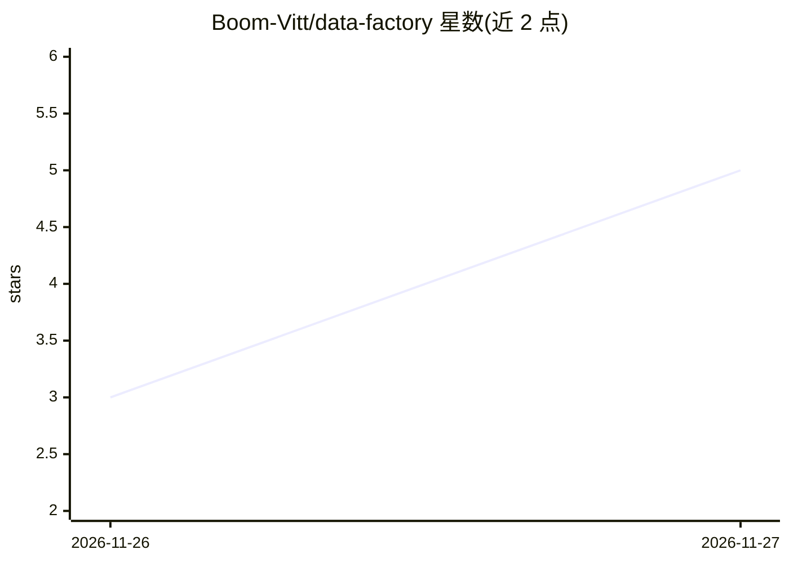

# Boom-Vitt/data-factory

⭐ 5 · Python · MIT · 推送 2026-11-23 · [GitHub](https://github.com/Boom-Vitt/data-factory) · 个人维护

**把多个 AI Agent 对话汇总为本地 JSONL 库，供搜索与微调**

单文件 Python 工具，将 Claude Code、Codex、Gemini CLI、Antigravity 等本地 Agent 已写入的对话记录收集为一个 JSONL 存储，支持按文件夹排除、增量更新、关键词搜索，并以 MCP 服务器形式接入各 AI 客户端提供 factory_log/factory_search/factory_show 三个工具。导出为 chat messages 格式的微调文件，可被 MLX、Unsloth、Axolotl、llama.cpp 等工具读取。数据不出本机，入口处按模式替换常见密钥形状，但对图像内容不脱敏。无数据库、无第三方依赖，Python 3.9+ 标准库实现。

## 筛选速览

| 维度 | 判定 | 备注 |
|---|---|---|
| AI 角色 | `ai-ecosystem` | LLM/agent 周边工具 |
| 许可风险 | `permissive` | MIT |
| 部署形态 | `desktop` | 安装包/桌面程序 |
| 模型依赖 | — | README 未给出锁定关系 |
| 硬件要求 | — | 无带数字的原话,不猜 |
| 安装摩擦 | `low` | 无编译、无系统依赖或容器化 |
| 成熟度 | — | 结构信号不足 |

## 能力要点

- 读取各 Agent 已有 transcript 汇总为单目录 JSONL，无需安装钩子
- 一个命令以 stdio MCP 服务器接入 Claude Code、Codex、Gemini CLI 等客户端
- export 生成微调工具（MLX/Unsloth/Axolotl/llama.cpp）可用的 train.jsonl
- 支持排除文件夹、密钥模式替换、媒体文件按内容哈希存储

## 适用场景

- 把散在各 Agent 隐藏目录里的对话集中起来本地搜索
- 积累自有提示-回答对用于本地模型微调
- 通过 MCP 让 Agent 检索和写入个人对话历史
- 构建 OCR 训练数据集索引

## 场景标签

`微调` `Agent 记忆` · 领域:Agent 开发

## 证据(README 行号)

> L13: - **One file, zero dependencies.** `factory.py` is plain Python standard library (3.9 or newer) and runs on macOS, 
> L17: - **One MCP server**, connected to all your agents with one command.
> L93: Any client that can launch a local (stdio) MCP server works. The command is `python3 /path/to/data-factory/factory.

## 星数曲线

2026-11-26 3 → 2026-11-27 5（+2）

---
*卡片 v1 · prompt 1.4 · 生成 2026-11-26 · 置信度 mid · 依据 README sha `0f6a35f221e3` · [字段定义](../../DATASET.md)*
