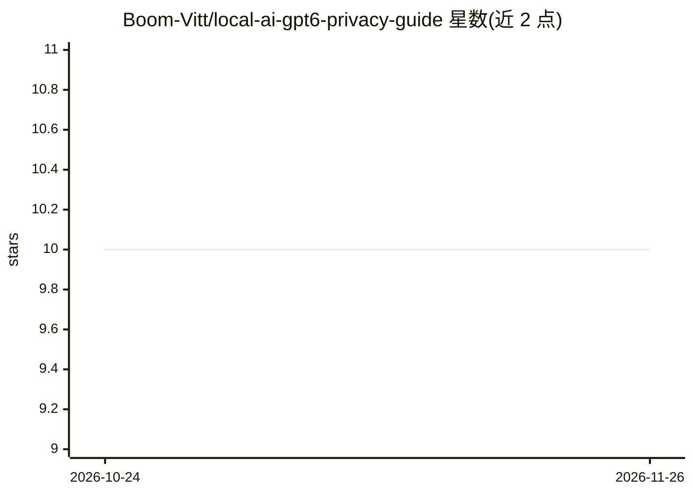

# Boom-Vitt/local-ai-gpt6-privacy-guide

⭐ 10 · Python · MIT · 推送 2026-10-22 · [GitHub](https://github.com/Boom-Vitt/local-ai-gpt6-privacy-guide) · 个人维护

**泰语优先的本地 AI 隐私工作流指南：本地处理+掩码后经批准上云**

以文档形式呈现的 Thai-first 指南，描述 local-first AI workflow：文档、PII 检测、掩码、检索与日常 AI 任务默认留在本地，Hermes 作为编排层，仅最小化掩码上下文经人工显式批准的 cloud gate 发往 GPT-6 Astra API，无静默云端回退。仓库仅包含文档与离线 dry-run payload 示例，不安装 runtime、不下载模型、不运行本地模型。声明为原则性指南而非生产级安全控制。

## 筛选速览

| 维度 | 判定 | 备注 |
|---|---|---|
| AI 角色 | `ai-knowledge` | 知识聚合/清单类 |
| 许可风险 | `permissive` | MIT |
| 部署形态 | `None` |  |
| 模型依赖 | — | README 未给出锁定关系 |
| 硬件要求 | — | 无带数字的原话,不猜 |
| 安装摩擦 | `medium` | 含编译或系统依赖之一 |
| 成熟度 | — | 结构信号不足 |

## 能力要点

- 5 项原则：local-first、本地掩码、最小上下文、显式批准、禁止静默回退
- 本地 PII 掩码示例，使用可逆 token map 并需在本地保留
- 按平台给出 vLLM/WSL2/vllm-metal 路线决策表
- 离线 dry-run 的 Responses API payload 示例（store=False）

## 适用场景

- 处理泰语敏感文档的本地 AI 工作流
- 需要掩码后才允许部分上下文上云的场景
- 为 agent 编排引入本地优先与显式批准门

## 场景标签

`教程课程` · 领域:学习与行业

## 证据(README 行号)

> L9: License: MIT Documentation status: guide Architecture: local-first Privacy: explicit gate Hermes: orchestration guid
> L15: This guide describes a local-first AI workflow for Thai-language data, with Hermes as the orchestration layer. Docu
> L78: ตารางนี้เป็นแผนที่สำหรับตัดสินใจเท่านั้น: repository นี้ไม่ติดตั้ง runtime, ไม่ดาวน์โหลด model และไม่รัน local mode

## 星数曲线

2026-10-24 10 → 2026-11-26 10（+0）

---
*卡片 v1 · prompt 1.4 · 生成 2026-11-20 · 置信度 high · 依据 README sha `65a89111ae99` · [字段定义](../../DATASET.md)*
